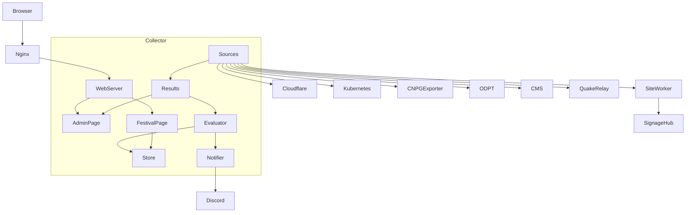
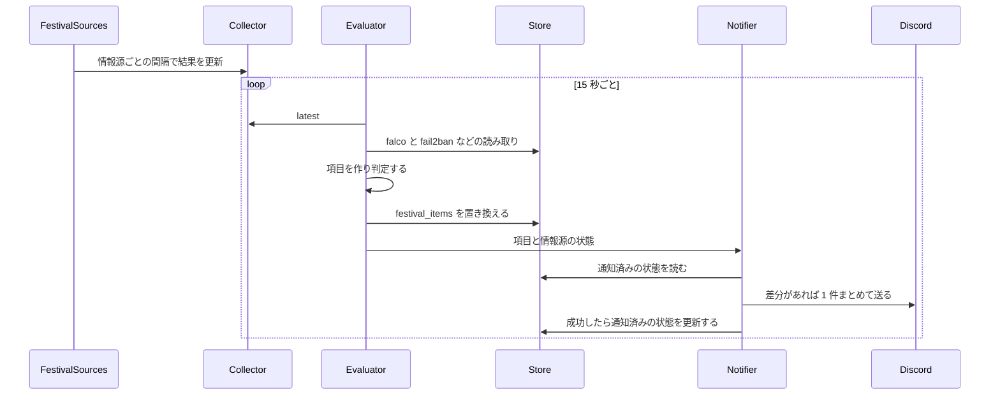
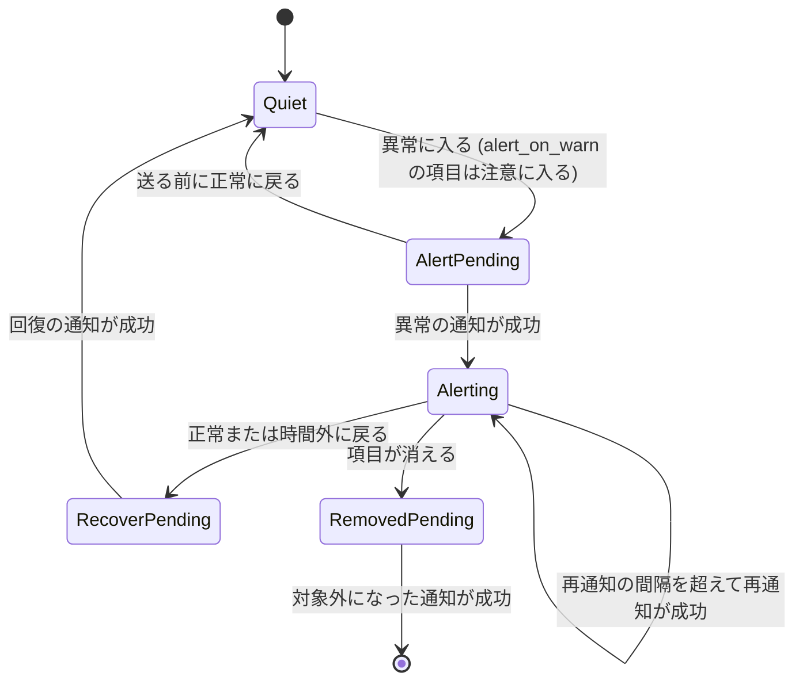
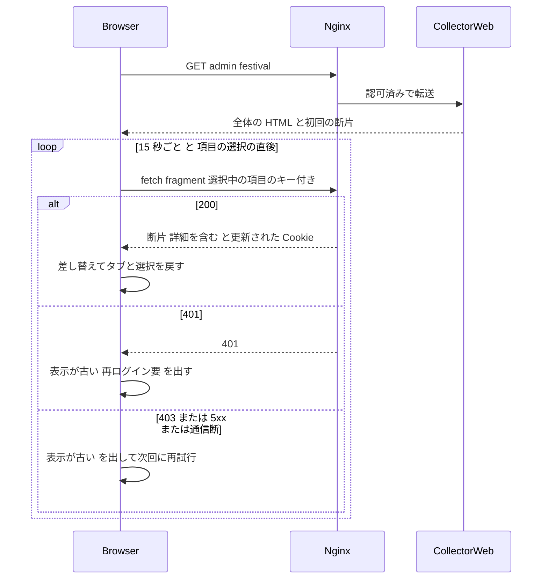
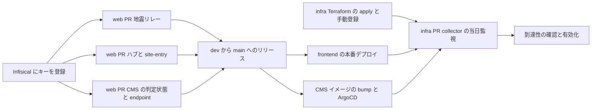

# Design Document: festival-ops-dashboard

## Overview

**Purpose**: 荒牧祭当日 (2026-11-14〜15) に本部で常時表示する当日監視画面 `/admin/festival` を、既存の運用ダッシュボード (ops-dashboard) の collector に追加する。来場者影響・機能別・容量・基盤とセキュリティの各項目を、3 段階の判定でタブに分けて表示する。異常に入った項目と回復した項目を Discord に通知する。

**Users**: admin グループの運営者が、本部の 1920×1080 の画面に開いたまま使う。手元の端末からも同じ画面を開ける。当日専用の Discord チャンネルを見ている運営者が、通知を受け取る。

**Impact**:
- collector に当日監視用の情報源 (`festival.*`)、評価・通知の処理、画面を足す。
- 画面の推移の表示のため、collector の既存の SQLite に、数値を持つ項目の 1 分ごとの値を 24 時間分だけ持つ。
- collector は閲覧専用から「通知もする」に変わる。外部に GET 以外 (当日専用の Discord webhook への POST) を発行する。
- 当日監視の評価が止まったことを、Healthchecks.io への定期的な ping の途絶で検知する。
- `/admin/` の表示と判定は変えない。
- aramakisai-web 側には読み取り専用の口を 3 つ足す。CMS の駐車場判定の状態、サイネージハブの接続元ごとの接続数、地震リレーの定期起動の時刻と読み取り専用トークン。

### Goals
- 画面を操作しなくても 15 秒ごとに表示が更新される。セッション切れや通信断で更新できないときは、そのことを画面に明示する。
- 各項目の判定・現在値・閾値・注記・時刻と直近 60 分の推移を、タイルに常に表示する。選んだ項目の当日の推移 (閾値の線つき) と内訳を、画面を遷移せずに表示する。
- 各項目を、コードで宣言した閾値で「正常・注意・異常」に判定する。値が古い・取れないときは「取得遅延」「取得失敗」として区別する。
- 画面を開いていなくても、異常に入った項目と回復した項目が当日専用の Discord チャンネルに届く。
- 当日監視そのものが止まったことを、当日監視に依存しない外部の監視 (Healthchecks.io) が通知する。
- 外部 API の問い合わせを、公開された上限の 1 割未満に収める。
- R1〜R9 をすべて開催前に本番に入れる。web 側の改修を先に進める。駐車場の項目は、設定で有効・無効を切り替えられる。

### Non-Goals
- 既存の `/admin/` の表示・判定の変更 (要確認の集計から当日監視の項目を除くことを除く)。
- 既存の監視・通知 (UptimeRobot・Healthchecks.io・Falco・Falcosidekick・DR Trigger・Infra Health Check・駐車場カメラ停止通知・地震リレーの Discord 通知) の置き換えや停止。
- メトリクスを時系列で保存する基盤 (Prometheus・VictoriaMetrics 等) の導入。推移の表示に使う値は、既存の SQLite に 24 時間分だけ持つ。
- 異常の自動是正 (スケール・再起動・切り替え)。
- ポータル (Homer) から当日監視画面への導線の追加。要件に無い。足す場合は、姉妹 spec `committee-timeline` も `ops-dashboard/portal/links.yaml` を変更する予定のため、衝突に注意する。
- 来場者向けサイト・サイネージ・CMS の機能そのものの変更。

## Boundary Commitments

### This Spec Owns
- collector の当日監視の情報源 (source_id `festival.*`) と、その取得の契約。
- 当日監視の評価・通知・描画 (collector の `festival/` パッケージ)。
- `dashboard.toml` の `[festival]` の宣言と、その検証 (`config.py`)。
- collector の SQLite に置く当日監視の表 (`festival_items`・`festival_alerts`・`festival_state`・`festival_history`)。
- 当日監視画面 `/admin/festival` と断片 `/admin/festival/fragment`、その画面表記と推移のグラフ。
- Discord への通知の内容・頻度・まとめ方 (collector が送るものに限る)。
- aramakisai-web に追加する次の口と記録 (実装は aramakisai-web の PR):
  - CMS: `parking_cameras` の判定状態の 4 項目と、その書き込み規則。読み取り専用の endpoint `GET /api/ops/parking-health`。
  - サイネージハブ: 接続元のタグ付けと、`GET /api/signage/stats`。
  - 地震リレー: 定期起動の最終実行時刻の記録と、`/status` の読み取り専用トークン。
- 新しいシークレットのキー (「Security Considerations」の表)。Cloudflare Access の collector 用サービストークン (`terraform/access.tf`)。
- 当日監視の生存確認の Healthchecks.io のチェック `festival-monitor` (`terraform/healthchecksio.tf`) と、その ping。

### Out of Boundary
- 既存の情報源 (`monitor.uptimerobot`・`monitor.healthchecks`・`connect.tunnel`・`ci.github`・`mail.fail2ban`) の取得内容と間隔。当日監視はこれらの結果を読むだけで、変更しない。
- Falco の検知ルールと Falcosidekick の送信先。
- 駐車場カメラの停止通知 (CMS) と地震リレーの Discord 通知の内容。
- 当日の体制・担当者・連絡経路 (WBS で管理する)。
- ops-dashboard spec の文書。過去の決定 (ADR) として扱い、書き換えない。境界の変更 (通知を始めること、Discord への POST) は、本書と steering (`tech.md` の監視スタック節) に書く。

### Allowed Dependencies
- collector の既存の部品: `Collector` の取得ループ、`model`、`http_client`、`k8s`、`store`、`render.components` の `esc` と `badge` の記号。
- Kubernetes API (nodes・pods・deployments・CNPG Cluster・`metrics.k8s.io` の nodes と pods)、各ノードの kubelet `:10250/stats/summary` と `:10250/metrics/cadvisor`、CNPG の instance の `:9187/metrics`。
- Cloudflare GraphQL Analytics API と Analytics Engine SQL API (既存の `OPS_CLOUDFLARE_READ_TOKEN`)。
- ODPT の公開フィード (鍵なし)。
- aramakisai-web の CMS (クラスタ内の Service 経由)、サイトの Worker (`aramakisai.com/api/signage/stats`、Cloudflare Access 経由)、地震リレー Worker (`/status`)。
- 当日専用の Discord webhook (`DISCORD_FESTIVAL_WEBHOOK_URL`)。他の送信元とは共用しない。
- Healthchecks.io の ping URL (`HEALTHCHECKS_FESTIVAL_MONITOR_PING_URL`)。
- 外部の状態を変える要求は、Discord への POST と Healthchecks.io への ping だけ。ほかの情報源には GET (と GraphQL の参照クエリ、AE の SELECT) だけを発行する。

### Revalidation Triggers
- `/status` (地震リレー)・`/api/signage/stats`・`/api/ops/parking-health` の応答形式の変更。
- Cloudflare GraphQL の dataset・フィールド名、Workers の `status` の値、AE の `aramakisai_stamp_metrics` の blob・double の割り当ての変更。
- CNPG のメジャー更新 (メトリクス名・ポート・カスタムクエリの書式)、metrics-server の更新。
- Kubernetes の更新による kubelet の `/stats/summary` の形・`/metrics/cadvisor` のメトリクス名・kubelet の認可の対応の変更。
- `parking_cameras` の判定状態の 4 項目の名前・意味の変更。
- `site_settings` の `parking_monitor`・`event_days` の形の変更。
- oauth2-proxy・nginx の認可経路の変更 (fetch の 401 の挙動)。
- ノード構成の変更 (collector は prod-node-1 に固定)。

## Architecture

### Existing Architecture Analysis
- collector は Python 3.13 slim と標準ライブラリだけで動く。コードは ConfigMap で配る。依存の向きは `config` → `sources/*` → `store` → `render` → `server`。
- 情報源は `sources/<name>.py` の `SOURCES` で宣言し、`sources/__init__.py` の `MODULES` に 1 行で登録する。情報源ごとに 1 スレッドで取得する。失敗は `Status.ERROR` になり、直前の items を保つ。
- `/admin/` の「要確認」(`page._flagged`) は、snapshot の全情報源を集計する。当日監視の結果を同じ snapshot に入れると、`/admin/` に混ざる (D-1)。
- `Collector.snapshot()` は、描画のたびに `security.falco` の render を実行する。当日監視の評価は snapshot を使わない。
- `HttpError` のメッセージは URL の path を含む。Discord の webhook はトークンを path に含むため、そのままでは失敗のログにトークンが出る。
- portal の nginx は `location /admin/` の前方一致で collector に転送し、admin 認可をかける。ページ遷移以外の未認証の要求には 401 を返す。`/admin/festival` と断片は、nginx を変えずに同じ認可がかかる。

### Architecture Pattern & Boundary Map



**Architecture Integration**:
- **Selected pattern**: 既存の collector の拡張 (ギャップ分析の案 C)。取得は既存の Source の仕組みに足す。評価・通知・描画は `festival/` パッケージに分ける。
- **Domain/feature boundaries**:
  - 取得層 (`sources/festival_*.py`) は外部の値を `Item` に変換するだけで、判定しない。
  - 評価層 (`festival/evaluate.py`・`festival/catalog.py`) は、取得結果と宣言から当日監視の項目を作り、判定する。
  - 通知層 (`festival/notify.py`) は、評価結果と通知済みの状態から送る内容を決めて送る。
  - 描画層 (`festival/page.py`・`festival/chart.py`) は、SQLite の評価結果と推移の記録を読むだけ。
- **Existing patterns preserved**: Source の登録、情報源ごとのスレッド、`Status`、宣言ファイルの厳格な検証、SQLite の単一ライター、ConfigMap による配布、nginx の認可。
- **New components rationale**:
  - 評価器: 判定と通知を描画から切り離す (D-3)。
  - 通知器: Discord への送信と、レート制限への追従。
  - 当日監視画面: タブ・タイルの大きさの決定・自動更新・選択状態の保持・画面内の詳細 (R3)。
  - 推移のグラフ (`festival/chart.py`): タイルのスパークラインと詳細の当日の折れ線を、サーバー側でインライン SVG にする。既存の `/admin/` のグラフ (`render/svg.py`) と同じく、外部の JS とライブラリを使わない。
- **Steering compliance**:
  - 時系列の保存基盤を置かない。推移は既存の SQLite に 24 時間分の 1 分値だけを持つ。
  - シークレットは Infisical と ExternalSecret で渡す。
  - IP アドレスを宣言に書かない。Pod とノードのアドレスは Kubernetes API から得る。
  - サブドメインと ArgoCD Application を増やさない。

**依存の向き** (左のものだけを import する。逆向きは誤り):

`config` → `model` → `http_client`・`k8s` → `sources/*` → `store` → `festival.catalog` → `festival.evaluate` → `festival.notify` → `festival.labels`・`festival.chart` → `festival.page` → `main`

- `festival.page` は `store`・`festival.labels`・`festival.chart` だけを読む。`festival.evaluate` と `festival.notify` を import しない。
- `festival.chart` は `model`・`festival.labels`・`render.components` の `esc`・`render.svg` の `_nice_max` だけを使う。
- `render/*` (既存) は `festival` を import しない。`festival.page` は `render.components` の `esc`・`JST`・`Raw`・`_MARK` を使ってよい。

### Technology Stack

| Layer | Choice / Version | Role in Feature | Notes |
|-------|------------------|-----------------|-------|
| Frontend | サーバー側描画の HTML とインライン SVG、ページ内の素の JavaScript (ビルドなし) | タブ、15 秒ごとの断片の差し替え、選択状態の保持、更新失敗の表示、スパークラインと当日の折れ線 | 新しい依存なし。グラフは既存の `render/svg.py` と同じくサーバー側の SVG |
| Backend | Python 3.13 slim、標準ライブラリだけ | 情報源・評価・通知・Web | protobuf・Prometheus テキストも自前の数十行で読む (D-13) |
| Data | 既存の SQLite (WAL、PVC `collector-data`) | 評価結果、通知状態、数値を持つ項目の 1 分値 (24 時間) | 新しい保存基盤を置かない (R9.1) |
| Messaging | Discord webhook、Healthchecks.io | 異常と回復の通知、当日監視の生存確認 | 当日専用の `DISCORD_FESTIVAL_WEBHOOK_URL` (D-14 改定)。Healthchecks.io は既存の Terraform provider |
| Infrastructure | ConfigMap 配布、ExternalSecret、Cloudflare Access サービストークン (Terraform) | 配布・シークレット・ハブへの認証 | 新しい ConfigMap `collector-festival` |
| Web (aramakisai-web) | Payload CMS、Cloudflare Workers・Durable Objects | 読み取り専用の口と判定状態の記録 | 既存の方式に従う |

## File Structure Plan

### Directory Structure
```
gitops/manifests/prod/ops-dashboard/collector/app/
├── sources/
│   ├── festival_cloudflare.py   # GraphQL 1 回 (alias) で Worker・CMS・メディア・Cache API・ハブ接続数と、状態・ステータスごとの内訳
│   ├── festival_stamp.py        # AE SQL でスタンプの処理結果
│   ├── festival_quake.py        # 地震リレー /status
│   ├── festival_signage.py      # サイトの Worker /api/signage/stats (Access のサービストークン)
│   ├── festival_parking.py      # CMS /api/ops/parking-health
│   ├── festival_schedule.py     # CMS site_settings (開催日・駐車場の監視時間)
│   ├── festival_bus.py          # ODPT の 2 フィードの header.timestamp
│   ├── festival_nodes.py        # ノードの Ready・CPU・メモリ・ディスク (k8s のノード一覧が正)
│   ├── festival_workloads.py    # CMS・DB・cloudflared の Pod (Ready・再起動・OOM・CPU 対 limit・メモリ・スロットリング・primary) と Pod ごとの内訳
│   ├── festival_cnpg.py         # CNPG の instance の :9187 (接続数・上限・replica 遅延・統計情報の無い表)
│   └── _promtext.py             # Prometheus テキスト形式の最小の読み取り
├── festival/                    # 新しい ConfigMap collector-festival で配る
│   ├── __init__.py
│   ├── catalog.py               # 項目の定義 (キー・区分・依存する情報源・閾値名・リンク・グラフの単位・内訳) と判定関数
│   ├── evaluate.py              # 15 秒ごとの評価スレッド。鮮度・取得失敗の扱いと SQLite への保存 (1 分値の記録を含む)
│   ├── notify.py                # 通知の差分計算と Discord への送信
│   ├── heartbeat.py             # Healthchecks.io への生存の ping
│   ├── page.py                  # /admin/festival の HTML と断片、タイルの格子の算出、詳細、CSS、JavaScript
│   ├── chart.py                 # スパークラインと当日の折れ線の SVG
│   └── labels.py                # 当日監視の画面表記 (本書「画面表記」が正本)
└── tests/
    ├── test_festival_config.py
    ├── test_festival_source_cloudflare.py
    ├── test_festival_source_stamp.py
    ├── test_festival_source_quake.py
    ├── test_festival_source_signage.py
    ├── test_festival_source_parking.py
    ├── test_festival_source_schedule.py
    ├── test_festival_source_bus.py
    ├── test_festival_source_nodes.py
    ├── test_festival_source_workloads.py
    ├── test_festival_source_cnpg.py
    ├── test_festival_catalog.py
    ├── test_festival_evaluate.py
    ├── test_festival_notify.py
    ├── test_festival_store.py
    ├── test_festival_chart.py
    └── test_festival_page.py
```

### Modified Files
- `collector/app/main.py`:
  - `/admin/festival` と `/admin/festival/fragment` の経路を足す。
  - `/admin/` に渡す snapshot から `festival.` で始まる結果を除く (D-1)。
  - `Collector.latest()` (結果の写し。render を実行しない) を足す。
  - 評価スレッドを起動する。
- `collector/app/config.py`: `[festival]` を `FestivalConfig` に読み込み、検証する (D-4)。
- `collector/app/store.py`: 当日監視の 4 表 (`festival_history` を含む) と、その読み書き・24 時間を過ぎた 1 分値の削除を足す。
- `collector/app/model.py`: `FestivalItem`・`AlertState`・`NotifierState`・`FestivalStateRow`・`Breakdown`・`MetricUnit` を足す。
- `collector/app/k8s.py`: `K8sClient.kubelet_text(node_ip, path)` を足す (kubelet の Prometheus テキスト。`/metrics/cadvisor`)。
- `collector/app/http_client.py`:
  - 応答の状態・ヘッダ・本文を返す `request_meta()` を足す。
  - `HttpError` に `retry_after` を持たせる。
  - URL を含めないエラー文の生成 (`redact_url=True`) を足す。
- `collector/app/sources/__init__.py`: `MODULES` に `festival_*` の 10 行を足す。
- `collector/dashboard.toml`:
  - `[festival]` 一式を足す。
  - `[[credentials]]` に「collector サイネージ Service Token」を足す。
- `collector/rbac.yaml`:
  - `metrics.k8s.io` の pods の get・list を足す (D-12)。
  - `apps` の deployments の get を足す (U-7)。
  - `""` の `nodes/metrics` の get を足す (kubelet の `/metrics/cadvisor`。festival.workloads)。
- `collector/external-secret.yaml`: 「Security Considerations」の 7 キーを足す。
- `collector/deployment.yaml`: initContainer に `festival/` のコピーを足し、volume `src-festival` を足す。
- `kustomization.yaml`:
  - `collector-sources` に新しいファイルを列挙する。
  - configMap `collector-festival` を足す (`festival/` の `__init__.py`・`catalog.py`・`chart.py`・`evaluate.py`・`heartbeat.py`・`labels.py`・`notify.py`・`page.py`)。
- `gitops/manifests/prod/cms/db-cluster.yaml`: Cluster `directus-db` に `spec.monitoring.customQueriesConfigMap` を足し、ConfigMap `directus-db-monitoring` のキー `queries` を参照する (festival.cnpg)。同じファイルを変更する別の PR (#437、未マージ) がある。
- `gitops/manifests/prod/cms/db-monitoring.yaml` (新規): ConfigMap `directus-db-monitoring` (namespace `prod`、ラベル `cnpg.io/reload`)。統計情報の無い表を数えるカスタムクエリを持つ。
- `gitops/manifests/prod/cms/kustomization.yaml`: `resources` に `db-monitoring.yaml` を足す。同じファイルを変更する別の PR (#437、未マージ) がある。
- `terraform/access.tf`: `aramakisai.com/api/signage/stats` だけを宛先にした専用の Access アプリと、collector 用のサービストークン・ポリシーを足す (U-2)。
- `terraform/healthchecksio.tf`・`terraform/outputs.tf`: チェック `festival-monitor` と、その ping URL の sensitive な output を足す (既存の `mailserver_backup` と同じ形)。
- `docs/ops-dashboard-runbook.md`: 当日監視画面の節を足す。
- `.kiro/steering/tech.md` (D-6):
  - 監視スタック節の運用ダッシュボードの行を「通知もする」に更新する。
  - シークレット一覧と、手動発行の資格情報の表に追記する。

aramakisai-web (別リポジトリの PR、base は dev):
- `cms/src/collections/parking-cameras.ts`: 判定状態の 4 項目 (グループ `judge_health`) を足す。
- `cms/src/migrations/<日時>_parking_camera_judge_health.ts`: 列を足す migration 1 本。
- `cms/src/lib/parking-judge-task.ts`: 判定の結果をカメラに記録する。
- `cms/src/endpoints/ops-parking-health.ts` (新規) と `cms/src/payload.config.ts` の `endpoints` への登録。
- `frontend/workers/signage-quake/relay-config.ts`・`http.ts`・`index.ts`・`rpc.ts`:
  - 読み取り用トークンを足す。
  - `cronTick()` と `/status` の `cron` を足す。
- `frontend/workers/signage-hub/index.ts`: 接続元のタグ付けと `stats()` を足す。
- `frontend/workers/site-entry.ts`: 接続元の受け渡しと `GET /api/signage/stats` を足す。
- `.github/workflows/frontend-ci.yml`: リレーの secrets-file に `SIGNAGE_QUAKE_STATUS_TOKEN` を足す。
- `infra` の `cms-secrets` の ExternalSecret: `OPS_PARKING_HEALTH_TOKEN` を足す。これは infra 側のファイルで、本仕様の infra PR に含める。

## System Flows

### 取得・評価・通知



- 評価は 15 秒ごと。1 回の評価の例外は記録して次の評価に進む。評価の失敗が `/admin/` と取得スレッドに及ばないようにする (R9.7)。
- 1 回の評価で送るのは最大 1 件。送り切れない分 (2000 文字を超える分や、`retry_after` の待ち) は、通知済みの状態が変わらないため、次の評価で送られる。

### 通知の状態 (項目または情報源ごと)



- 異常を宣言しない閾値の項目 (`alert_on_warn = True`) は、「注意」を異常と同じ扱いにする。注意に入ると通知し、注意から正常または時間外に戻ると回復を通知する。
- `alert_on_warn = False` の項目では、「注意」と「取得遅延」「取得失敗」は異常の状態を変えない (通知も回復もしない)。異常の途中で注意に下がった場合も、回復とはみなさない。`alert_on_warn = True` の項目でも、「取得遅延」「取得失敗」は状態を変えない。
- 情報源の取得失敗 (`Status.ERROR`)、または取得時刻が鮮度の上限を超えた状態が `source_failure_grace` 以上続くと、情報源の単位で 1 件の通知にする (R8.4)。その情報源に依存する項目は、項目としては通知しない。

### 画面の更新



- fetch は `credentials: 'same-origin'`、`cache: 'no-store'`、`redirect: 'manual'` で、10 秒で打ち切る。
- 詳細 (当日の折れ線・内訳) は、選択中の項目のキーを付けた同じ断片に含めて返す。項目を選んだ直後にも断片を取り直す。詳細のための別の経路は設けない。
- oauth2-proxy は、認証付きの要求のたびに、前回から 1 時間を超えていれば refresh し、Cookie を 12 時間に延ばす (RN-12)。15 秒ごとの fetch が refresh を兼ねるため、稼働時間内は再ログインなしで続く。

## Requirements Traceability

| Requirement | Summary | Components | Interfaces | Flows |
|-------------|---------|------------|------------|-------|
| 1.1 | `/admin/festival` で提供 | FestivalWeb | `GET /admin/festival` | 画面の更新 |
| 1.2 | admin だけに表示 | FestivalWeb (既存 nginx) | nginx `location /admin/` | 画面の更新 |
| 1.3 | 拒否・認証へ誘導 | FestivalWeb (既存 nginx) | 302・401・403 | 画面の更新 |
| 1.4 | 当日に不要な情報を出さない | FestivalCatalog | 項目の定義 | — |
| 1.5 | `/admin/` を変えない | AdminSnapshotFilter | `admin_snapshot()` | — |
| 2.1 | 30 秒以内の自動更新 | FestivalPage (JS) | `GET /admin/festival/fragment` | 画面の更新 |
| 2.2 | 取得時刻の表示 | FestivalEvaluator、FestivalPage | `FestivalItem.fetched_at`・`observed_at` | — |
| 2.3 | 取得遅延 | FestivalEvaluator | `max_age` の宣言 | 取得・評価・通知 |
| 2.4 | 取得失敗と他の項目の継続 | Collector (既存)、FestivalEvaluator | `Status.ERROR` | 取得・評価・通知 |
| 2.5 | 更新失敗の明示 | FestivalPage (JS) | 401・5xx・通信断の扱い | 画面の更新 |
| 3.1 | 3 段階と色・文字 | FestivalPage、FestivalLabels | 画面表記 | — |
| 3.2 | 4 区分のタブ | FestivalPage | `Category`、タブの DOM | — |
| 3.3 | 宣言から閾値・期待値 | FestivalConfig | `[festival]` | — |
| 3.4 | 宣言の変更だけで反映 | FestivalConfig | ConfigMap のハッシュによる再起動 | — |
| 3.5 | 共通の帯 (件数・異常の項目名・最終更新) | FestivalPage | 帯の DOM | 画面の更新 |
| 3.6 | タイルに判定・現在値・閾値・注記・データの時刻を常に表示 | FestivalPage | タイルの DOM | — |
| 3.7 | 選択で画面内に推移と内訳、リンクは補助 | FestivalPage、FestivalCatalog | 断片の `key`、詳細パネル、`ItemGroup.link`・`link_label` | 画面の更新 |
| 3.8 | 1920×1080 でスクロールなし | FestivalPage | レイアウトの予算 | — |
| 3.9 | タブ見出しに最悪の判定と異常件数 | FestivalPage | タブの DOM | — |
| 3.10 | 更新中も選択中のタブを維持 | FestivalPage (JS) | `ViewState` | 画面の更新 |
| 3.11 | タイルのスパークライン (直近 60 分) | FestivalCatalog、FestivalEvaluator、Store、FestivalChart | `FestivalItem.metric`・`unit`、`festival_history` | 取得・評価・通知 |
| 3.12 | 詳細の当日の折れ線と閾値の線 | FestivalChart、FestivalPage | `FestivalItem.warn`・`crit`、`festival_history` | 画面の更新 |
| 3.13 | 記録の無い期間は線を途切れさせる | FestivalEvaluator、FestivalChart | 1 分値の記録の規則、欠測の描き方 | — |
| 3.14 | 内訳の表 | 各 festival 情報源、FestivalCatalog、FestivalPage | `Breakdown`、`festival_items.breakdown` | — |
| 3.15 | 項目数に応じたタイルの大きさ | FestivalPage | `tile_grid()` | — |
| 3.16 | 更新中も選択中の項目の詳細を維持し更新 | FestivalPage (JS) | `ViewState.selectedItemKey`、断片の `key` | 画面の更新 |
| 4.1 | Worker の要求数・エラー率・リソース超過・CPU | festival.cloudflare、FestivalCatalog | GraphQL `workers` | 取得・評価・通知 |
| 4.2 | CMS の要求数・5xx 比率・origin 応答時間 | festival.cloudflare | GraphQL `cms` | 取得・評価・通知 |
| 4.3 | Worker のキャッシュ照会を除外 | festival.cloudflare | `requestSource_in` の許可リスト | — |
| 4.4 | メディアの 4xx・5xx | festival.cloudflare | GraphQL `media` | 取得・評価・通知 |
| 4.5 | UptimeRobot の UP・DOWN | FestivalCatalog (既存 `monitor.uptimerobot`) | 既存の Item | — |
| 4.6 | 遅延による過小評価を避ける | festival.cloudflare、festival.stamp | 時間窓 `[floor(now)-8m, floor(now)-3m)` | — |
| 5.1 | カメラごとの最終受信 | festival.parking、FestivalCatalog | `ParkingHealthResponse` | 取得・評価・通知 |
| 5.2 | カメラごとの判定の最終成功・最終失敗・直近のエラー・連続失敗 | CMS の判定状態、festival.parking | `judge_health`、`ParkingHealthResponse` | 取得・評価・通知 |
| 5.3 | 本番からのサイネージ接続数 | SignageHub、SiteEntry、festival.signage | `GET /api/signage/stats` | 取得・評価・通知 |
| 5.4 | 地震リレーの定期起動の継続 | QuakeRelay、festival.quake | `/status` の `cron.lastRunAt` | 取得・評価・通知 |
| 5.5 | 上流ごとの接続・最終受信・Discord の成否 | festival.quake | `/status` の `channels`・`discord` | 取得・評価・通知 |
| 5.6 | スタンプの記録失敗・D1 失敗・レート制限 | festival.stamp | AE SQL | 取得・評価・通知 |
| 5.7 | バスのフィードの成否と生成時刻 | festival.bus | `header.timestamp` | 取得・評価・通知 |
| 5.8 | 期間外を異常にしない | festival.schedule、FestivalCatalog | `Status.EMPTY` (時間外) | — |
| 6.1 | CMS の Pod | festival.workloads | Pod・Deployment・`metrics.k8s.io` pods | 取得・評価・通知 |
| 6.2 | DB primary の CPU・接続数 | festival.workloads、festival.cnpg | `:9187` | 取得・評価・通知 |
| 6.3 | replica の遅延 | festival.cnpg | `cnpg_pg_replication_lag` | 取得・評価・通知 |
| 6.4 | 全ノード | festival.nodes | k8s nodes、kubelet、`metrics.k8s.io` nodes | 取得・評価・通知 |
| 6.5 | Tunnel | FestivalCatalog (既存 `connect.tunnel`) | 既存の Item | — |
| 6.6 | DB の instance ごとのメモリ (rss) 対 limit | festival.workloads | kubelet `/stats/summary` の `rssBytes`、Pod の memory limit | 取得・評価・通知 |
| 6.7 | DB の instance の再起動・OOM・CrashLoop | festival.workloads | Pod の `containerStatuses`、`restart_window` | 取得・評価・通知 |
| 6.8 | DB の instance ごとの接続数 | festival.cnpg | `:9187` の `cnpg_backends_total` | 取得・評価・通知 |
| 6.9 | cloudflared の CPU 対 limit | festival.workloads | `metrics.k8s.io` pods | 取得・評価・通知 |
| 6.10 | CMS と cloudflared の CPU スロットリング率 | festival.workloads | kubelet `/metrics/cadvisor` | 取得・評価・通知 |
| 6.11 | CMS へのリクエストのレート | festival.cloudflare、FestivalCatalog | GraphQL `cms`・`media` | 取得・評価・通知 |
| 6.12 | Cache API のヒット率 | festival.cloudflare、FestivalCatalog | GraphQL `cms_cache` | 取得・評価・通知 |
| 6.13 | 閾値未宣言の項目は表示だけ | FestivalCatalog、FestivalEvaluator、FestivalNotifier、FestivalPage | `Judgement.judged`、`fest.status.info` | 取得・評価・通知 |
| 6.14 | 統計情報の無い表の数 | festival.cnpg、CNPG のカスタムクエリ | `cnpg_festival_unanalyzed_tables_count` | 取得・評価・通知 |
| 7.1 | dr-incident・infra-alert | FestivalCatalog (既存 `ci.github`) | 既存の Item | — |
| 7.2 | Falco の優先度別件数 | FestivalCatalog | `falco_events` (SQLite) | 取得・評価・通知 |
| 7.3 | IdP と CMS DB 経由の応答 | FestivalCatalog (既存 `monitor.uptimerobot`) | モニター名の宣言 | — |
| 7.4 | Healthchecks.io | FestivalCatalog (既存 `monitor.healthchecks`) | 既存の Item | — |
| 7.5 | 内部アドレスの BAN | FestivalCatalog (既存 `mail.fail2ban`、festival.nodes) | ノードのアドレスと podCIDRs | 取得・評価・通知 |
| 8.1 | 異常の通知 | FestivalNotifier | Discord のメッセージ | 通知の状態 |
| 8.2 | 回復の通知 | FestivalNotifier | Discord のメッセージ | 通知の状態 |
| 8.3 | 再通知の間隔 | FestivalNotifier | `renotify` | 通知の状態 |
| 8.4 | 情報源単位のまとめ | FestivalNotifier | `source_failure_grace` | 通知の状態 |
| 8.5 | 送信失敗の表示 | FestivalNotifier、FestivalPage | `festival_state`、項目 `infra.notifier` | — |
| 8.6 | 既存の通知を変えない | FestivalNotifier | 当日専用の webhook。既存の送信先を使わない | — |
| 8.7 | 当日監視の停止の検知 | FestivalHeartbeat | Healthchecks.io の ping | 取得・評価・通知 |
| 9.1 | 時系列の保存基盤なし、SQLite に 24 時間分の 1 分値 | Store、FestivalEvaluator | `festival_history` (1 分に 1 点、24 時間で削除) | 取得・評価・通知 |
| 9.2 | 外部 API のレート制限 | 各 festival 情報源、FestivalNotifier | 「Performance & Scalability」の表 | — |
| 9.3 | 読み取りに限る | 各 festival 情報源 | GET・参照クエリだけ。読み取り専用トークン | — |
| 9.4 | シークレットを出さない | http_client、FestivalNotifier | `redact_url`、`safe_error` | — |
| 9.5 | 個人を識別できる情報を出さない | festival.cloudflare、FestivalCatalog | 次元の選択。fail2ban は件数だけ | — |
| 9.6 | メモリの明示 | Collector の Deployment | 実測の手順と見積り | — |
| 9.7 | 停止しても他に影響しない | FestivalEvaluator、AdminSnapshotFilter | 例外の分離 | 取得・評価・通知 |

## Components and Interfaces

| Component | Domain/Layer | Intent | Req Coverage | Key Dependencies (P0/P1) | Contracts |
|-----------|--------------|--------|--------------|--------------------------|-----------|
| FestivalConfig | config | `[festival]` の宣言の読み込みと検証 | 3.3, 3.4, 6.13 | tomllib (P0) | Service |
| festival.cloudflare | sources | Worker・CMS・メディア・Cache API・ハブ接続数と、状態・ステータスごとの内訳 | 3.14, 4.1–4.4, 4.6, 5.3, 6.11, 6.12 | Cloudflare GraphQL (P0) | Batch |
| festival.stamp | sources | スタンプの処理結果 | 5.6, 4.6 | AE SQL (P0) | Batch |
| festival.quake | sources | 地震リレーの状態 | 5.4, 5.5 | QuakeRelay `/status` (P0) | Batch |
| festival.signage | sources | 本番からのハブ接続数 | 5.3 | SiteEntry `/api/signage/stats` (P0)、CF Access (P0) | Batch |
| festival.parking | sources | カメラごとの受信と判定の状態 | 5.1, 5.2 | CMS endpoint (P0) | Batch |
| festival.schedule | sources | 開催日と駐車場の監視時間 | 5.8 | CMS `site_settings` (P1) | Batch |
| festival.bus | sources | バスのフィードの生成時刻 | 5.7 | ODPT (P0) | Batch |
| festival.nodes | sources | ノードの Ready・資源 | 6.4, 7.5 | k8s API (P0)、kubelet (P1) | Batch |
| festival.workloads | sources | CMS・DB・cloudflared の Pod と Pod ごとの内訳 | 3.14, 6.1, 6.2, 6.6, 6.7, 6.9, 6.10 | k8s API (P0)、metrics.k8s.io (P1)、kubelet (P1) | Batch |
| festival.cnpg | sources | DB の接続数・遅延・統計情報の無い表 | 6.2, 6.3, 6.8, 6.14 | CNPG `:9187` (P1) | Batch |
| FestivalCatalog | festival | 項目の定義と判定、グラフの値と閾値、内訳 | 1.4, 3.3, 3.7, 3.11, 3.12, 3.14, 4.x, 5.x, 6.x, 7.x | FestivalConfig (P0) | Service |
| FestivalEvaluator | festival | 15 秒ごとの評価と保存、1 分値の記録 | 2.2–2.4, 3.11, 3.13, 6.13, 9.1, 9.7 | Collector (P0)、Store (P0) | Service, State |
| FestivalHeartbeat | festival | Healthchecks.io への生存の ping | 8.7 | Healthchecks.io (P1) | Service |
| FestivalNotifier | festival | Discord への通知 | 6.13, 8.1–8.6, 9.2, 9.4 | Discord (P0)、Store (P0) | Service, State |
| FestivalPage | festival | 画面と断片、タイルの格子、画面内の詳細 | 1.1, 2.1, 2.5, 3.1, 3.2, 3.5–3.16, 6.13 | Store (P0)、FestivalChart (P0) | API, State |
| FestivalChart | festival | スパークラインと当日の折れ線の SVG | 3.11, 3.12, 3.13 | Store の 1 分値 (P0) | Service |
| AdminSnapshotFilter | main | `/admin/` から `festival.*` を除く | 1.5 | Collector (P0) | Service |
| ParkingJudgeHealth (web) | CMS | 判定の状態をカメラに記録 | 5.2 | Payload DB (P0) | State |
| OpsParkingHealthEndpoint (web) | CMS | 判定の状態の読み取り | 5.1, 5.2 | Payload (P0) | API |
| SignageHub stats (web) | Workers | 接続元ごとの接続数 | 5.3 | DO WebSocket タグ (P0) | API |
| QuakeRelay status (web) | Workers | 定期起動の時刻と読み取り専用トークン | 5.4, 5.5, 9.3 | DO storage (P0) | API |

### config

#### FestivalConfig

| Field | Detail |
|-------|--------|
| Intent | `dashboard.toml` の `[festival]` を型付きの値にし、起動時に検証する |
| Requirements | 3.3, 3.4, 6.13 |

**Responsibilities & Constraints**
- 既存の `Config` に `festival: FestivalConfig | None` を足す。`[festival]` が無ければ `None` で、当日監視の情報源・評価・通知は何もしない。その場合、`/admin/festival` は「未設定」を表示する。
- 未知のキー、閾値名の欠け、注意と異常の大小の逆転 (両方を宣言したとき)、未知の source_id は、起動の失敗にする (既存の流儀)。
- 閾値の `crit` は省略できる。省略した閾値は注意までを判定し、異常にしない。`warn` は省略できない。
- `[festival.max_age]` は、次の 15 個の source_id すべての宣言を必須にする (欠ければ起動の失敗)。`festival.*` の 10 個 (`cloudflare`・`stamp`・`quake`・`signage`・`parking`・`schedule`・`bus`・`nodes`・`workloads`・`cnpg`) と、`monitor.uptimerobot`・`monitor.healthchecks`・`connect.tunnel`・`ci.github`・`mail.fail2ban`。
- 閾値の向き (`THRESHOLD_DIRECTIONS`)、省略できる閾値名 (`OPTIONAL_THRESHOLDS`)、必須の source_id (`FESTIVAL_SOURCE_IDS`・`FESTIVAL_MAX_AGE_SOURCES`) は `config.py` の定数に置く。
  - 例外として、FestivalCatalog が「省略できる」とした閾値名 (`cms_rps`・`cms_cache_hit_ratio`・`stamp_failed`・`stamp_d1_failed`・`stamp_rate_limited`・`db_replica_lag_s`・`db_backends`・`node_memory_ratio`・`db_unanalyzed_tables`・`parking_judge_failures`・`parking_judge_success_age`) は欠けてよい。欠けている間、その項目は判定せず表示だけを行う (6.13)。
- 期間は既存の `parse_duration` (`30m`・`36h`・`8d`) を使う。
- 非公開の閾値: 環境変数 `OPS_FESTIVAL_PRIVATE_THRESHOLDS` (JSON のオブジェクト。キーは閾値名、値は `[festival.thresholds]` と同じ形の `{"warn": …, "crit": …}`。`crit` は省略でき、期間は toml と同じ書式の文字列) を、`[festival.thresholds]` に足し合わせる。
  - 同じ閾値名が両方にあれば `ConfigError`。向き・逆転・未知の閾値名は toml の閾値と同じ規則で検証する。
  - 環境変数が無い、または空なら足さない。JSON が壊れているときは `ConfigError` にし、エラー文に値を出さない。
- 開催日と駐車場の監視時間は宣言しない。CMS の `site_settings` が正本 (D-7)。

**Contracts**: Service [x]

##### Service Interface
```python
from dataclasses import dataclass
from datetime import timedelta
from typing import Literal, Mapping

Direction = Literal["above", "below"]  # above: 値が大きいほど悪い

@dataclass(frozen=True)
class Threshold:
    warn: float | timedelta
    crit: float | timedelta | None   # None は異常を宣言しない

@dataclass(frozen=True)
class FestivalConfig:
    page_url: str                                  # 通知に載せる当日監視画面の URL
    renotify: timedelta
    source_failure_grace: timedelta
    max_age: Mapping[str, timedelta]               # source_id -> 鮮度の上限
    thresholds: Mapping[str, Threshold]            # 閾値名 -> 注意・異常 (異常は省略できる)。省略できる閾値名は欠けてよい (後述)
    min_requests: Mapping[str, int]                # 比率の判定に要る最低要求数
    cloudflare: "CloudflareTargets"
    parking: "ParkingTarget"
    signage: "SignageTarget"
    quake_url: str          # "https://aramakisai-signage-quake.aramakisai.workers.dev"
    bus_feed_base: str      # 末尾にフィード名を付けて取る基底 URL
    disabled_sources: list[str]   # 取得も評価もしない source_id。既定は空
    cms: "CmsTargets"
    cloudflared: "CloudflaredTarget"
    uptime_monitors: Mapping[Literal["idp", "cms_db"], str]   # UptimeRobot のモニター名
    falco: "FalcoTarget"

@dataclass(frozen=True)
class CloudflareTargets:
    worker_script: str      # "aramakisai-web"
    cms_host: str           # "cms.aramakisai.com"
    media_path_like: str    # "/api/media/%"
    hub_object_name: str    # "signage-hub"

@dataclass(frozen=True)
class ParkingTarget:
    enabled: bool           # web 側の反映前は false (D-15)

@dataclass(frozen=True)
class SignageTarget:
    url: str                # https://aramakisai.com/api/signage/stats

@dataclass(frozen=True)
class CmsTargets:
    namespace: str          # "prod"
    deployment: str         # "cms"
    pod_selector: str       # "app=cms"
    db_cluster: str         # "directus-db"
    service_base: str       # "http://cms.prod.svc.cluster.local:80"
    restart_window: timedelta   # CMS と DB の Pod の直近の再起動・OOM を表示する窓。30m

@dataclass(frozen=True)
class CloudflaredTarget:
    namespace: str          # "cloudflared"
    pod_selector: str       # "app=cloudflared" (Deployment cloudflared の selector)

@dataclass(frozen=True)
class FalcoTarget:
    window: timedelta
    warn_priority: str      # この優先度以上を注意
    crit_priority: str      # この優先度以上を異常

def parse_festival(raw: Mapping[str, object], private_thresholds: str | None = None) -> FestivalConfig: ...  # 誤りは ConfigError。private_thresholds は OPS_FESTIVAL_PRIVATE_THRESHOLDS の値
```
- Preconditions: TOML として正しい。
- Postconditions: `crit` を宣言した各閾値で、`above` の項目は warn ≤ crit、`below` の項目は warn ≥ crit が成り立つ。向きは `FestivalCatalog` の定義と照合する。
- Invariants: 宣言の値はプロセスの生存中は変わらない。変更は ConfigMap のハッシュが変わることによる Pod の再作成で反映される (3.4)。

**Implementation Notes**
- Validation: `test_festival_config.py` で、欠け・逆転・未知のキーが起動の失敗になることを確かめる。
- Risks: 根拠のある閾値だけを宣言する。根拠の無い項目は宣言せず表示のみにし、開催前の負荷試験とリハーサルで記録してから決める (Migration Strategy)。

### sources (取得層)

すべての `festival.*` の情報源に共通する契約:
- `Source(source_id, interval, fetch)` で宣言し、`MODULES` に登録する。`festival` の宣言が無ければ `fetch` は `Status.EMPTY` の結果を返し、外部に問い合わせない。
- 判定はしない。`Item.status` は常に `Status.OK` とし、値だけを `Item.values` に入れる (判定は FestivalCatalog の責務)。例外として、1 ノードの kubelet や 1 Pod の 9187 に届かないときは、その要素の Item を `Status.STALE` にして理由を `note` に入れる (既存の `node.resources` の流儀)。
- 失敗 (HTTP エラー、429、GraphQL の `errors`、解釈できない応答) は例外として送り出す。既存の `Collector._execute` が `Status.ERROR` に変換し、直前の items を保つ。同じ周期内でのリトライはしない (D-11)。
- `Item.values` には、データの時刻 `observed_at` (ISO 8601、UTC) を必要に応じて入れる。取得時刻は `SourceResult.fetched_at`。
- 個人を識別できる値 (IP、端末識別子) を `Item` に入れない (9.5)。fail2ban の IP は既存の `mail.fail2ban` の items にあるが、当日監視は照合に使うだけで、表示・保存しない。
- 内訳 (3.14) は、その周期の問い合わせで既に受け取っている値だけを、`Item.values` の配列 (`by_status`・`by_cache_status`・`by_pod`) に残す。内訳のために問い合わせを足さない。配列の各要素は数値と文字列だけの辞書にする (`result_to_json` でそのまま保存できる形)。

| source_id | 間隔 | 取得先 | 主な Item (キー: values) |
|---|---|---|---|
| `festival.cloudflare` | 60 秒 | GraphQL 1 回 (alias で 5 つ) | `worker`: requests, errors, exceeded, cpu_p99_ms, window_end, by_status<br>`cms`: requests, status_5xx, origin_p95_ms, window_end, by_status<br>`media`: requests, status_4xx, status_5xx, window_end, by_status<br>`cms_cache`: lookups, hits, window_end, by_cache_status<br>`hub_total`: connections, minute |
| `festival.stamp` | 60 秒 | AE SQL 1 回 | `stamp`: failed, rate_limited, d1_failed, window_end |
| `festival.quake` | 60 秒 | 地震リレー `/status` | `cron`: last_run_at, in_period<br>`channel.<name>`: connected, receiving, last_received_at, test<br>`unreachable`: value<br>`discord`: configured, disabled, last_success_at, last_failure_at, last_failure |
| `festival.signage` | 60 秒 | `/api/signage/stats` | `connections`: prod, dev, preview, unknown, at |
| `festival.parking` | 60 秒 | `/api/ops/parking-health` | `camera.<id>`: name, lot, last_captured_at, device_received_at, judge_last_succeeded_at, judge_last_failed_at, judge_last_error, judge_consecutive_failures, lot_status_updated_at |
| `festival.schedule` | 5 分 | `site_settings` (認証なし) | `monitor`: start, end<br>`event_day.<n>`: start_at, end_at |
| `festival.bus` | 30 秒 | ODPT の `trip_update`・`vehicle` | `feed.trip_update`・`feed.vehicle`: header_timestamp |
| `festival.nodes` | 60 秒 | k8s nodes、`metrics.k8s.io` nodes、kubelet | `node.<name>`: ready, cpu_ratio, memory_ratio, disk_ratio, addresses_count<br>(アドレスと podCIDRs は fail2ban の照合用に、メモリ内の値として評価器に渡す。後述) |
| `festival.workloads` | 30 秒 | k8s pods・deployments・CNPG Cluster・`metrics.k8s.io` pods、対象の Pod があるノードの kubelet (`/stats/summary`・`/metrics/cadvisor`) | `cms`: replicas, ready, restarts_recent, oom_recent, crashloop, cpu_ratio_max, throttle_ratio_max, by_pod<br>`db.<pod>`: role, cpu_ratio, memory_rss_ratio, restarts_recent, oom_recent, crashloop, ip<br>`cloudflared`: pods, cpu_ratio_max, throttle_ratio_max, by_pod |
| `festival.cnpg` | 30 秒 | 各 DB の Pod の `:9187/metrics` | `db.<pod>`: role, backends, max_connections, replication_lag_s, unanalyzed_tables (primary だけ) |

#### festival.cloudflare

| Field | Detail |
|-------|--------|
| Intent | 来場者影響の数値を、Cloudflare GraphQL の 1 回の問い合わせで取る |
| Requirements | 4.1, 4.2, 4.3, 4.4, 4.6, 5.3 (参考値), 6.11, 6.12 |

**Responsibilities & Constraints**
- 時間窓は `[floor(now)-8分, floor(now)-3分)` (5 分幅、D-11)。`floor` は分単位の切り捨て。
- alias:
  - `workers`: `workersInvocationsAdaptive`。`scriptName` で絞り、`status` の次元で数える。errors の和、`status = exceededResources` の要求数、CPU 時間の p99 (`quantiles.cpuTimeP99`。単位はマイクロ秒のため ms に換算する) を取る。
  - `cms`: account スコープの `httpRequestsAdaptiveGroups`。`clientRequestHTTPHost = cms_host`、`requestSource_in: ["eyeball","edgeWorkerFetch"]` で絞る。`edgeResponseStatus` の次元と、origin 応答時間の p95 (`quantiles.originResponseDurationMsP95`。単位は ms) を取る。
  - `media`: `cms` の条件に `clientRequestPath_like: media_path_like` を足す。メディアにも許可リストを掛ける。理由は、R4.3 の除外が CMS の 5xx 全体にかかるため。`edgeResponseStatus` ごとの件数の和を `requests` にも入れる (6.11 のレートでメディアを除くため)。
  - `cms_cache`: `clientRequestHTTPHost = cms_host`、`requestSource = edgeWorkerCacheAPI`、HTTP メソッドが GET の要求 (`clientRequestHTTPMethodName = "GET"`) に絞り、キャッシュの状態 (`dimensions.cacheStatus`) の次元で数える。全件を `lookups`、`hit` の件数を `hits` にする (6.12)。PUT はキャッシュへの書き込みなので数えない。
  - `hub_total`: `durableObjectsPeriodicGroups`。ハブの `name` で絞り、直近 10 分の `datetimeMinute` ごとの `max.activeWebsocketConnections` を取る。
- 要求の無い分は行が返らない (RN-4)。そのため、行が無い窓は件数 0 として扱う。
- 接続数 (`hub_total`) は最新の分の値を使う。その分が `floor(now)-4分` より古ければ、Item の `note` に取得遅延を記し、評価器が「取得遅延」にする。
- 次元に `clientIP`・`clientRequestPath` の全体・User-Agent などは選ばない (9.5)。
- 内訳 (3.14): 合計に畳んでいた行を、畳む前の形でも残す。
  - `worker.by_status`: `workers` の行ごとに `{status, requests, errors}`。
  - `cms.by_status`・`media.by_status`: `edgeResponseStatus` ごとに `{status, count}`。同じステータスの行は足し合わせる。
  - `cms_cache.by_cache_status`: `cacheStatus` ごとに `{cache_status, count}`。

**Dependencies**
- External: Cloudflare GraphQL Analytics API — 5 分で 300 クエリ (P0)。

**Contracts**: Batch [x]

##### Batch / Job Contract
- Trigger: 60 秒ごと (取得スレッド)。
- Input / validation: `OPS_CLOUDFLARE_READ_TOKEN`、`TF_VAR_cloudflare_account_id`。応答に `errors` があれば例外にする。
- Output / destination: `SourceResult` (`Collector.results`、SQLite の `source_results`)。
- Idempotency & recovery: 毎回、窓全体を取り直す。失敗したら次の周期を待つ。

**Implementation Notes**
- Integration: 既存の `billing_cloudflare.py` の GraphQL 呼び出しと `errors` の扱いを流用する。
- Validation: 応答の fixture から Item の値を検算する。
- Risks:
  - Workers の指標にはプレビューの要求も混ざる (RN-5・research)。比率の判定には最低要求数を設ける。
  - 上記のフィールド名は、スキーマの introspection で存在を確かめた (`AccountWorkersInvocationsAdaptiveQuantiles`、`AccountHttpRequestsAdaptiveGroupsFilter_InputObject`・`Dimensions`・`Quantiles`)。公開ドキュメントにはフィールドの一覧が無い。
  - `cms_cache` の alias を足しても、HTTP の要求は毎分 1 回のまま (GraphQL の問い合わせ数は増えない)。

#### festival.stamp
- AE SQL の 1 回の SELECT で数える。条件は `blob1 = 'prod'` と、`festival.cloudflare` と同じ時間窓。
  - `outcome` (blob3) が `failed` と `rate_limited` の件数を `SUM(_sample_interval)` で数える。
  - `d1Failed` (double7) が真の件数を数える。
- AE の反映遅延は未実測。リハーサルで実測するまで、同じ窓を仮置きにする (RN-4)。
- 書き込みが 1 件も無い窓は 0 として扱う。

#### festival.quake
- 地震リレーの `GET /status` に、読み取り専用トークン `SIGNAGE_QUAKE_STATUS_TOKEN` を Bearer で付ける。`SIGNAGE_QUAKE_TOKEN` (`/dismiss` 用) は collector に渡さない (D-8)。
- URL は、cms Deployment の env `SIGNAGE_QUAKE_URL` と同じ値を `[festival]` に宣言する。
- 応答に `cron` が無い (改修前のリレー) 場合は、`cron` の Item を作らない。その場合、評価器が定期起動の項目を「取得失敗」(理由: 未対応の応答) にする。

#### festival.signage
- `GET /api/signage/stats` に、Cloudflare Access のサービストークンのヘッダ (`CF-Access-Client-Id`・`CF-Access-Client-Secret`) を付ける。値は `OPS_SIGNAGE_ACCESS_CLIENT_ID`・`OPS_SIGNAGE_ACCESS_CLIENT_SECRET`。
- Access に阻まれた応答 (ログイン画面への 302 や HTML) は、JSON として解釈できないので取得失敗になる。

#### festival.parking
- `[festival.parking] enabled = false` の間は、問い合わせずに `Status.EMPTY` を返す (D-15)。
- `GET <service_base>/api/ops/parking-health` に、Bearer `OPS_PARKING_HEALTH_TOKEN` を付ける。経路はクラスタ内の CMS Service で、Cloudflare を経由しない。

#### festival.schedule
- `GET <service_base>/api/globals/site_settings?depth=0` を認証なしで呼び、`parking_monitor` と `event_days` だけを Item にする (D-7)。
- 取得に失敗した場合は、直前の値で判定を続ける (既存の ERROR の扱い)。値が一度も無いときは、時間の判定ができない。その場合、駐車場の項目を「取得失敗」にする。

#### festival.bus
- 2 つのフィード (`trip_update`・`vehicle`) を、30 秒ごとに GET する (D-13)。基底 URL は web 側と同じ ODPT の公開フィードで、`[festival]` に宣言する。
- `FeedMessage.header` (field 1、length-delimited) の `timestamp` (field 3、varint) だけを、標準ライブラリの数十行の varint 読みで取り出す。それ以外は読み飛ばす。
- 片方のフィードの失敗は、その Item を `STALE` にして理由を記す。両方とも失敗したら例外にする。

```python
def read_header_timestamp(feed: bytes) -> int:
    """FeedMessage.header.timestamp (epoch 秒) を返す。見つからなければ ValueError。"""
```

#### festival.nodes
- 期待集合は Kubernetes のノード一覧 (D-5)。`[[servers]]` は使わない。
- ノードごとに、Ready の condition、`metrics.k8s.io` の CPU・メモリ使用量対 capacity、kubelet `/stats/summary` のルートディスクの使用率を取る。1 ノードの kubelet に届かなければ、そのノードのディスクだけ `STALE` にする。
- fail2ban の照合用に、ノードの `status.addresses` の全アドレスと `spec.podCIDRs` を取る。これらは IP なので `Item.values` に入れない。情報源のモジュール内の変数に最新値を保持し、評価器は `sources.festival_nodes.internal_networks()` を呼んで受け取る。

```python
import ipaddress

def internal_networks() -> tuple[ipaddress.IPv4Network | ipaddress.IPv6Network, ...]:
    """直近の取得で得たノードのアドレス (/32・/128) と podCIDRs。未取得なら空。"""
```

#### festival.workloads
- CMS:
  - `apps/v1` の Deployment `cms` の `spec.replicas` (U-7) と、セレクタに一致する Pod を取る。
  - Ready の Pod の数。
  - 直近の再起動。`lastState.terminated.finishedAt` が `[festival.cms] restart_window` (30m) 以内のもの。
  - OOMKilled と CrashLoopBackOff の有無。OOMKilled の有無は `restart_window` 以内の終了だけを数える。
  - `metrics.k8s.io` の pods の CPU 使用量と、コンテナの CPU limit の比の最大値。
  - CPU のスロットリング率の Pod ごとの最大値 (後述)。
- DB:
  - CNPG の Cluster `status.currentPrimary` で primary を決める。
  - 各 instance の Pod の CPU 使用量対 limit と Pod IP を取る (Pod IP は `festival.cnpg` が使う。表示しない)。
  - 各 instance の Pod の直近の再起動・OOMKilled・CrashLoopBackOff を、CMS と同じ規則と同じ窓 (`restart_window`) で取る (6.7)。
  - 各 instance の Pod のメモリ使用量対 memory limit (6.6)。使用量は kubelet `/stats/summary` の `pods[].containers[].memory.rssBytes` で、Pod の `podRef` (namespace・name) とコンテナ名で突き合わせる。memory limit を持つコンテナごとに `rssBytes ÷ limit` を求め、その最大値を `memory_rss_ratio` にする。`workingSetBytes` と cgroup の `memory.current` はページキャッシュを含み、平常時でも limit 近くになるため使わない。
- cloudflared (6.9):
  - `[festival.cloudflared]` の namespace (`cloudflared`) と Pod のラベルセレクタ (`app=cloudflared`。Deployment `cloudflared` の `spec.selector`) で Pod を取る。
  - `metrics.k8s.io` の pods の CPU 使用量と、コンテナの CPU limit の比を Pod ごとに求め、その最大値を `cpu_ratio_max` にする。CMS の `cpu_ratio_max` と同じ取り方。Pod 名はロールアウトで変わるため、項目は Pod ごとに分けず最大値の 1 つにする。
  - CPU のスロットリング率の Pod ごとの最大値 (後述)。
- CPU のスロットリング率 (6.10。CMS と cloudflared):
  - 対象の Pod が載っているノードの kubelet `:10250/metrics/cadvisor` を GET し、`_promtext.py` で `container_cpu_cfs_throttled_periods_total` と `container_cpu_cfs_periods_total` を読む。`namespace`・`pod` のラベルが対象の Pod に一致し、`container` のラベルが空でない行だけを使う。
  - 前回の取得との差分で、`Δthrottled_periods ÷ Δperiods` をコンテナごとに求め、Pod ごと・対象 (CMS・cloudflared) ごとの最大値を `throttle_ratio_max` にする。前回の値はモジュール内に保持する。
  - `Δperiods` が 0 の行は 0 とする (CPU を使う期間が無かった)。前回の値が無い行 (初回・新しい Pod・カウンタの減少) は、その周期の計算から除く。対象のすべての行が除かれた場合は、Item の `note` に取得遅延を記す。
- 内訳 (3.14): `cms.by_pod` は Pod ごとに `{pod, ready, cpu_ratio, throttle_ratio, restarts_recent, oom_recent, crashloop}`、`cloudflared.by_pod` は Pod ごとに `{pod, cpu_ratio, throttle_ratio}`。最大値を求める前の Pod ごとの値をそのまま残す。DB は instance ごとに Item (`db.<pod>`) があるため足さない。
- kubelet への経路: `festival.nodes` と同じ k8s モジュールの kubelet 呼び出し (Pod の `spec.nodeName` から得たノードの InternalIP の 10250 番、ServiceAccount トークン) を使う。`/stats/summary` は既存の `nodes/stats` の権限で読める。1 ノードの kubelet に届かなければ、そのノードの Pod のメモリとスロットリングだけを欠かし、他は続ける。
- RBAC: `metrics.k8s.io` の pods の get・list (D-12)、`apps` の deployments の get (U-7)、`nodes/metrics` の get (kubelet の `/metrics/*` は resource `nodes`・subresource `metrics` で認可される) を足す。

#### festival.cnpg
- `festival.workloads` の最新の結果から DB の Pod IP と役割を受け取り、各 Pod の `http://<PodIP>:9187/metrics` を GET する。
  - 依存の向きを守るため、Pod IP は `Collector` ではなく `sources.festival_workloads.db_endpoints()` (モジュール内の最新値) から得る。
- `_promtext.py` で次の値を読む:
  - `cnpg_backends_total` の全系列の和 (Pod ごと。primary に限らず全 instance。6.8 の接続数と、primary の接続率の両方に使う)
  - `cnpg_pg_settings_setting{name="max_connections"}`
  - replica の `cnpg_pg_replication_lag`
  - primary の `cnpg_festival_unanalyzed_tables_count` (6.14。下記のカスタムクエリ)
- 1 Pod に届かなければ、その Pod の Item を `STALE` にする。全 Pod に届かなければ例外にする。

**統計情報の無い表のカスタムクエリ (6.14)**:
- CNPG (オペレーター 1.23.3) のカスタムクエリで出す。Cluster `directus-db` の `spec.monitoring.customQueriesConfigMap` に `{name: directus-db-monitoring, key: queries}` を足し、同じ namespace (`prod`) に ConfigMap を置く。ConfigMap にはラベル `cnpg.io/reload` を付け、内容の変更をインスタンスに自動で読み直させる。
- `customQueriesConfigMap` の追加・変更では、Pod の再作成も PostgreSQL の再起動も起きず、primary は切り替わらない (CNPG v1.23.3 のソース)。
  - オペレーターが Pod の再作成を決める判定 (`internal/controller/cluster_upgrade.go` の `isPodNeedingRollout` (292〜356 行) と `checkPodSpecIsOutdated` (572〜617 行)) は、`specs.CreateClusterPodSpec` で作った PodSpec と比べる。`pkg/specs` で `Spec.Monitoring` を参照するのは `roles.go` (151〜178 行、instance manager の Role に ConfigMap の読み取りを足す) と `podmonitor.go` (48〜50 行) だけで、PodSpec には入らない。
  - instance manager は Cluster の reconcile のたびに `reconcileMonitoringQueries` (`internal/management/controller/instance_controller.go` 126〜127 行・754〜830 行) で ConfigMap を読み直し、`metricsServerExporter.SetCustomQueries` で指標のエクスポーターのクエリだけを差し替える。
  - ConfigMap の内容の変更は、オペレーターが `status.configMapResourceVersion` に記録し (`internal/controller/cluster_status.go` 547〜562 行)、Cluster の変更として instance manager の reconcile を起こす。
- 指標は既存の 9187 番に `cnpg_<クエリ名>_<列名>` の名前で出る。
- クエリは既定では Cluster の main database で実行される。`directus-db` は recovery で作った Cluster で、CMS のデータベース `payload` は PreSync Job が作るため、`target_databases` で `payload` を明示する。

```yaml
festival_unanalyzed_tables:
  query: |
    SELECT count(*) AS count
    FROM pg_stat_user_tables
    WHERE last_analyze IS NULL AND last_autoanalyze IS NULL
  primary: true
  target_databases: ["payload"]
  metrics:
    - count:
        usage: GAUGE
        description: "統計情報が一度も取得されていない表の数"
```
- `primary: true` のため、replica はこの指標を出さない。collector は primary の値だけを評価する。

```python
from typing import Iterable, Mapping

def parse_samples(text: str, names: Iterable[str]) -> Mapping[str, list[tuple[Mapping[str, str], float]]]:
    """Prometheus テキスト形式から、指定した名前のサンプル (ラベルと値) を返す。"""
```

**到達できなかった場合の扱い (D-12)**:
- 9187 番・10250 番・CMS の Service に collector の Pod から届くかは未実測 (RN-8)。実装の最初のタスクで、collector の Pod から次の 3 つを確かめる:
  - 全 DB の Pod の 9187 番 (他のノードの Pod を含む)
  - 全ノードの 10250 番
  - CMS の Service
- 届かなかった場合:
  - 該当する項目は「取得失敗」と理由 (接続できない) を表示し続ける。他の項目と通知は動き続ける。
  - 情報源の単位の通知を止めるため、`[festival]` の `disabled_sources` に source_id を書けば、その情報源を取得も評価もしない (表示は「無効」)。
  - 届かなかった場合は、原因を添えてユーザーに諮り、代わりの経路を決めてもらう (U-8)。決まるまでは `disabled_sources` で該当する情報源を止め、他の作業を進める。

### festival (評価・通知・描画)

#### FestivalCatalog

| Field | Detail |
|-------|--------|
| Intent | 当日監視の項目を定義し、取得結果と宣言から判定する |
| Requirements | 1.4, 3.3, 3.7, 3.11, 3.12, 3.14, 4.1–4.6, 5.1–5.8, 6.1–6.14, 7.1–7.5 |

**Responsibilities & Constraints**
- 項目の一覧と判定の規則は、コードとして宣言する。閾値・期待値は `FestivalConfig` から読む (3.3)。
- 当日の異常把握に使わない情報 (課金・利用枠・DMARC・TLS-RPT・メール配送) は、定義に含めない (1.4)。
- 1 つの項目キーは 1 つの区分に属する。
- 判定の結果は `Status.OK`・`WARN`・`CRIT`・`EMPTY` (時間外)。`ERROR` と `STALE` は FestivalEvaluator が上書きする。
- 表示のみの項目 (6.13): 閾値名が `OPTIONAL_THRESHOLDS` にあり、`[festival.thresholds]` に宣言されていない項目は、`status = Status.OK`・`threshold = None`・`judged = False` の `Judgement` を返す。`function.parking.judge.<id>` は 2 つの閾値名のうち宣言したものだけで判定し、どちらも宣言されていないときに表示のみにする。
  - FestivalEvaluator は、取得失敗・取得遅延の上書きを判定する項目と同じく行う。
  - FestivalNotifier は `judged = False` の項目を計画しない (通知しない)。
  - FestivalPage は判定の文字を「表示のみ」(`fest.status.info`) にし、正常の色を使わない。帯とタブ見出しの件数・最悪の判定には数えない。
  - 閾値を宣言すれば、宣言の変更だけで通常の判定に変わる (3.4)。
  - `visitor.worker.requests` (項目名「Worker 要求数」、現在値「{requests} 件」)・`function.signage.prod` (項目名「サイネージ接続数 (本番)」、現在値「{prod} 台」) は閾値名を持たない表示のみの項目で、`judge` が `judged = False` の `Judgement` を直接返す。表示・通知・件数の扱いは上と同じ。
- 異常を宣言しない閾値 (`crit` が `None`): `grade` は注意までを返し、異常を返さない。`threshold_text` は「注意 ≥ x」だけを返し、グラフの閾値の線は `crit` を `None` にする。この閾値で判定する項目は `alert_on_warn = True` にし、注意で通知する (FestivalNotifier)。
- グラフの値 (3.11・3.12): グラフの対象の項目 (後述の表) は、表示用の文字 (`value`) とは別に、数値 (`metric`)・単位 (`unit`)・閾値の線の値 (`warn`・`crit`) を `Judgement` に入れる。`metric` の単位は `unit` に従い、期間の閾値 (`timedelta`) は秒に換算する。表示のみの項目は `warn`・`crit` を `None` にする。
- 内訳 (3.14): 内訳を持つ項目 (後述の表) は、情報源の結果から表示用に整形した `Breakdown` を `Judgement` に入れる。内訳のために情報源へ問い合わせを足さない。

**Contracts**: Service [x]

##### Service Interface
```python
from dataclasses import dataclass
from datetime import datetime
from enum import StrEnum
from typing import Callable, Iterable, Mapping

from model import Breakdown, MetricUnit, SourceResult, Status

class Category(StrEnum):
    VISITOR = "visitor"      # 来場者影響
    FUNCTION = "function"    # 機能別
    CAPACITY = "capacity"    # 容量
    INFRA = "infra"          # 基盤・セキュリティ

@dataclass(frozen=True)
class Judgement:
    key: str
    label: str
    status: Status
    value: str                      # 表示用の現在値
    threshold: str | None           # 表示用の閾値 (「注意 ≥ 3.0% / 異常 ≥ 10.0%」)
    observed_at: datetime | None    # データの時刻 (取得時刻と異なるとき)
    note: str | None = None
    judged: bool = True             # False は表示のみ (閾値が未宣言。6.13)
    alert_on_warn: bool = False     # True は注意で通知する (異常を宣言しない閾値の項目)
    metric: float | None = None     # グラフの値。グラフの対象でない項目と、値を算出できないときは None
    unit: MetricUnit | None = None  # None はグラフの対象外
    warn: float | None = None       # 閾値の線 (metric と同じ単位)。閾値が無い・表示のみのときは None
    crit: float | None = None
    breakdown: Breakdown | None = None

# 宣言を省略できる閾値名 (表示のみにする項目の閾値名) は config.py の OPTIONAL_THRESHOLDS に置く

@dataclass(frozen=True)
class EvalInput:
    now: datetime
    config: "FestivalConfig"
    results: Mapping[str, SourceResult]
    falco_counts: Mapping[str, int]                  # 優先度 -> 窓内の件数
    internal_networks: tuple[object, ...]            # festival_nodes.internal_networks()
    state: "FestivalStateRow | None" = None          # infra.notifier・infra.heartbeat の入力 (festival_state)
    notifier_configured: bool = True                 # 通知の webhook が設定されているか
    heartbeat_configured: bool = True                # ping URL が設定されているか

@dataclass(frozen=True)
class ItemGroup:
    """同じ規則で 0 個以上の項目を作る定義 (カメラごと・ノードごと等)。"""
    key_prefix: str
    category: Category
    sources: tuple[str, ...]        # 依存する source_id。取得失敗・鮮度の判定に使う
    link: str | None                # 参照先 (3.7)
    link_label: str | None          # 参照先の名前の表記キー (fest.link.*)。link が None なら None
    notify: bool                    # False は通知しない (infra.notifier 自身など)
    judge: Callable[[EvalInput], Iterable[Judgement]]

CATALOG: tuple[ItemGroup, ...]
```
- Preconditions: `judge` は依存する情報源の結果が無いとき、項目を作らずに空を返す (評価器が「取得失敗」の項目を作る)。
- 閾値の向き (`THRESHOLD_DIRECTIONS`)・`OPTIONAL_THRESHOLDS`・検証用の定数は `config.py` に置き、FestivalCatalog が参照する。
- Postconditions: 返す `Judgement.key` は `key_prefix` で始まり、CATALOG 全体で一意。

**項目の一覧** (閾値名は `[festival.thresholds]` のキー):

| 区分 | 項目キー | 依存する情報源 | 判定 | 閾値名 | 参照先 |
|---|---|---|---|---|---|
| 来場者影響 | `visitor.worker.requests` | festival.cloudflare | 要求数 (5 分の窓)。閾値を持たず、常に表示のみ (`judged = False`) | — | Cloudflare ダッシュボード |
| 来場者影響 | `visitor.worker.error_rate` | festival.cloudflare | errors ÷ requests (最低要求数未満は正常) | `worker_error_rate` | Cloudflare ダッシュボード |
| 来場者影響 | `visitor.worker.exceeded` | festival.cloudflare | exceededResources の件数 | `worker_exceeded` | Cloudflare ダッシュボード |
| 来場者影響 | `visitor.worker.cpu_p99` | festival.cloudflare | CPU 時間の p99 (ms) | `worker_cpu_p99_ms` | Cloudflare ダッシュボード |
| 来場者影響 | `visitor.cms.5xx_rate` | festival.cloudflare | 5xx ÷ 要求数 (最低要求数未満は正常) | `cms_5xx_rate` | Cloudflare ダッシュボード |
| 来場者影響 | `visitor.cms.origin_p95` | festival.cloudflare | origin 応答時間の p95 (ms) | `cms_origin_p95_ms` | Cloudflare ダッシュボード |
| 来場者影響 | `visitor.media.4xx` | festival.cloudflare | 4xx の件数 | `media_4xx` | Cloudflare ダッシュボード |
| 来場者影響 | `visitor.media.5xx` | festival.cloudflare | 5xx の件数 | `media_5xx` | Cloudflare ダッシュボード |
| 来場者影響 | `visitor.uptime.<id>` | monitor.uptimerobot | 既存の判定 (down は異常、paused は注意) | — | `/admin/#sec-monitoring` |
| 機能別 | `function.parking.capture.<id>` | festival.parking, festival.schedule | 最終受信からの経過。最終受信の時刻が無いときは異常 (時間外は時間外) | `parking_capture_age` | CMS 管理画面 |
| 機能別 | `function.parking.judge.<id>` | festival.parking, festival.schedule | 連続失敗回数と最終成功からの経過の悪い方。最終成功の時刻が無いときは経過を異常とする (時間外は時間外) | `parking_judge_failures`、`parking_judge_success_age` | CMS 管理画面 |
| 機能別 | `function.signage.prod` | festival.signage | 本番の接続数。閾値を持たず、常に表示のみ (`judged = False`) | — | Cloudflare ダッシュボード |
| 機能別 | `function.quake.cron` | festival.quake | 最終実行からの経過。期間内で最終実行の時刻が無いときは異常 (期間外は時間外) | `quake_cron_age` | — |
| 機能別 | `function.quake.channel.<name>` | festival.quake | receiving が偽なら注意。`unreachable` が真なら全系統を異常 (期間外は時間外)。定期起動の情報が無い応答では期間内として扱う | — | — |
| 機能別 | `function.quake.discord` | festival.quake | disabled は異常。configured が偽、または最終失敗が最終成功より新しい場合は注意 | — | — |
| 機能別 | `function.stamp.failed` | festival.stamp | 記録失敗の件数 | `stamp_failed` | Cloudflare ダッシュボード |
| 機能別 | `function.stamp.d1_failed` | festival.stamp | D1 失敗の件数 | `stamp_d1_failed` | Cloudflare ダッシュボード |
| 機能別 | `function.stamp.rate_limited` | festival.stamp | レート制限の件数 | `stamp_rate_limited` | Cloudflare ダッシュボード |
| 機能別 | `function.bus.<feed>` | festival.bus | 生成時刻からの経過。開催日で絞らず、常に判定する (U-5) | `bus_feed_age` | — |
| 容量 | `capacity.cms.ready` | festival.workloads | Ready ÷ 宣言数 (下回るほど悪い)。宣言数が 0 のときは Ready 率 0 として扱い、異常 | `cms_ready_ratio` | `/admin/#sec-cluster` |
| 容量 | `capacity.cms.restarts` | festival.workloads CrashLoopBackOff の Pod があれば異常、なければ正常。再起動・OOM は現在値の文字に出し、判定しない。CrashLoop は `restart_window` に依存しない (現在の `waiting` 状態) | — | `/admin/#sec-cluster` |
| 容量 | `capacity.cms.cpu` | festival.workloads | CPU 対 limit の最大 | `pod_cpu_ratio` | Netdata |
| 容量 | `capacity.db.primary_cpu` | festival.workloads | primary の CPU 対 limit | `pod_cpu_ratio` | Netdata |
| 容量 | `capacity.db.connections` | festival.cnpg | primary の接続数 ÷ 上限 | `db_connections_ratio` | `/admin/#sec-data` |
| 容量 | `capacity.db.backends.<pod>` | festival.cnpg | instance ごとのクライアント接続数 (全 instance) | `db_backends` | `/admin/#sec-data` |
| 容量 | `capacity.db.memory.<pod>` | festival.workloads | instance ごとのメモリ (rss) 対 memory limit | `db_memory_rss_ratio` | Netdata |
| 容量 | `capacity.db.restarts` | festival.workloads | 全 instance のうち CrashLoopBackOff の Pod があれば異常、なければ正常 (`capacity.cms.restarts` と同じ)。再起動・OOM は現在値の文字に出し、判定しない。該当する Pod 名を表示 | — | `/admin/#sec-cluster` |
| 容量 | `capacity.db.unanalyzed` | festival.cnpg | primary の、統計情報が一度も取得されていない表の数 | `db_unanalyzed_tables` | `/admin/#sec-data` |
| 容量 | `capacity.db.lag.<pod>` | festival.cnpg | replica の遅延 (秒) | `db_replica_lag_s` | `/admin/#sec-data` |
| 容量 | `capacity.cms.throttle` | festival.workloads | CMS の Pod の CPU スロットリング率の最大 | `cpu_throttle_ratio` | Netdata |
| 容量 | `capacity.cms.rps` | festival.cloudflare | (`cms` の requests − `media` の requests) ÷ 窓の秒数 (300) | `cms_rps` | Cloudflare ダッシュボード |
| 容量 | `capacity.cms.cache_hit` | festival.cloudflare | `cms_cache` の hits ÷ lookups (lookups が 0 なら値なし)。閾値の宣言が無い間は表示のみ | `cms_cache_hit_ratio` | Cloudflare ダッシュボード |
| 容量 | `capacity.cloudflared.cpu` | festival.workloads | cloudflared の Pod の CPU 対 limit の最大 | `pod_cpu_ratio` | Netdata |
| 容量 | `capacity.cloudflared.throttle` | festival.workloads | cloudflared の Pod の CPU スロットリング率の最大 | `cpu_throttle_ratio` | Netdata |
| 容量 | `capacity.node.<name>.ready` | festival.nodes | NotReady は異常 | — | Netdata |
| 容量 | `capacity.node.<name>.cpu` | festival.nodes | 使用率 | `node_cpu_ratio` | Netdata |
| 容量 | `capacity.node.<name>.memory` | festival.nodes | 使用率 | `node_memory_ratio` | Netdata |
| 容量 | `capacity.node.<name>.disk` | festival.nodes | ルートディスクの使用率 | `node_disk_ratio` | `/admin/#sec-node` |
| 容量 | `capacity.tunnel` | connect.tunnel | 既存の状態の判定と、接続数 | `tunnel_connections` | `/admin/#sec-connect` |
| 基盤・セキュリティ | `infra.incidents` | ci.github | dr-incident があれば異常、infra-alert があれば注意。件数と表題の一覧 | — | `/admin/#sec-cluster` |
| 基盤・セキュリティ | `infra.falco` | (SQLite の falco_events) | 窓内の優先度別の件数。`crit_priority` 以上は異常、`warn_priority` 以上は注意 | — | `/admin/#sec-falco` |
| 基盤・セキュリティ | `infra.idp` | monitor.uptimerobot | `uptime_monitors.idp` のモニターの状態。UptimeRobot の結果があるのに宣言したモニターが見つからなければ注意 (「モニターが見つかりません」) | — | `/admin/#sec-monitoring` |
| 基盤・セキュリティ | `infra.cms_db` | monitor.uptimerobot | `uptime_monitors.cms_db` のモニターの状態。UptimeRobot の結果があるのに宣言したモニターが見つからなければ注意 (「モニターが見つかりません」) | — | `/admin/#sec-monitoring` |
| 基盤・セキュリティ | `infra.healthchecks.<id>` | monitor.healthchecks | 既存の判定 | — | `/admin/#sec-monitoring` |
| 基盤・セキュリティ | `infra.fail2ban.internal` | mail.fail2ban, festival.nodes | 内部アドレスの BAN が 1 件以上なら異常。件数だけを表示 | — | `/admin/#sec-fail2ban` |
| 基盤・セキュリティ | `infra.notifier` | (festival_state) | 未設定・最終失敗が最終成功より新しい場合は注意。通知しない | — | — |
| 基盤・セキュリティ | `infra.heartbeat` | (festival_state) | ping が未設定、または最終失敗が最終成功より新しい場合は注意。通知しない | — | Healthchecks.io のコンソール |

- `visitor.uptime.<id>` からは、`infra.idp`・`infra.cms_db` に割り当てたモニターを除く。同じモニターを 2 つの項目にしないためで、IdP と CMS DB 経由の応答は基盤の区分に表示する。
- 時間外 (5.8):
  - 駐車場の項目は、今日が `event_days` のいずれかの日 (`start_at` を JST に直した日付) で、かつ `parking_monitor` の時間内 (`end` ちょうどを含む) のときだけ判定する。それ以外は `EMPTY` (時間外)。
  - 地震リレーの項目は、`/status` の `inPeriod` が偽なら `EMPTY`。
  - 規則は RN-13 の公開ページの判定に揃える。
  - `festival.parking` が無効 (`parking.enabled = false`) の間は、`festival.schedule` が有効でも駐車場の項目を作らない。
- 参照先の Cloudflare ダッシュボードは、アカウント ID を含まないトップの URL にする。アカウント ID はこのリポジトリでは秘匿扱いのため。
- 参照先の名前 (`link_label`): Cloudflare ダッシュボードは `fest.link.cloudflare`、Netdata は `fest.link.netdata`、`/admin/#…` は `fest.link.admin`、CMS 管理画面は `fest.link.cms`、Healthchecks.io のコンソールは `fest.link.healthchecks`。

**グラフの対象 (3.11・3.12)**: 次の表の項目だけがグラフ (タイルのスパークラインと詳細の当日の折れ線) を持つ。表に無い項目 (Ready・再起動・定期起動・上流・Discord 通知・UptimeRobot・Healthchecks.io・Falco など、状態を表す項目) は持たない。駐車場の 2 項目は、時間外 (`EMPTY`) の間は記録されない (1 分値の記録の規則)。

| 項目キー | 値 (`metric`) | 単位 | 閾値の線 |
|---|---|---|---|
| `visitor.worker.requests` | 要求数 (5 分の窓) | `count` | なし |
| `visitor.worker.error_rate` | errors ÷ requests (requests が 0 なら 0)。最低要求数未満でも値は入れる | `ratio` | `worker_error_rate` |
| `visitor.worker.exceeded` | exceededResources の件数 (5 分の窓) | `count` | `worker_exceeded` |
| `visitor.worker.cpu_p99` | CPU 時間の p99 | `ms` | `worker_cpu_p99_ms` |
| `visitor.cms.5xx_rate` | 5xx ÷ 要求数 (要求数が 0 なら 0) | `ratio` | `cms_5xx_rate` |
| `visitor.cms.origin_p95` | origin 応答時間の p95 | `ms` | `cms_origin_p95_ms` |
| `visitor.media.4xx` | 4xx の件数 (5 分の窓) | `count` | `media_4xx` |
| `visitor.media.5xx` | 5xx の件数 (5 分の窓) | `count` | `media_5xx` |
| `function.parking.capture.<id>` | 最終受信からの経過 (最終受信の時刻が無いときは None) | `seconds` | `parking_capture_age` |
| `function.parking.judge.<id>` | 判定の連続失敗回数 | `count` | `parking_judge_failures` |
| `function.signage.prod` | 本番の接続数 | `count` | なし |
| `function.stamp.failed` | 記録失敗の件数 (5 分の窓) | `count` | `stamp_failed` |
| `function.stamp.d1_failed` | D1 失敗の件数 (5 分の窓) | `count` | `stamp_d1_failed` |
| `function.stamp.rate_limited` | レート制限の件数 (5 分の窓) | `count` | `stamp_rate_limited` |
| `function.bus.<feed>` | 生成時刻からの経過 | `seconds` | `bus_feed_age` |
| `capacity.cms.cpu` | CPU 対 limit の最大 | `ratio` | `pod_cpu_ratio` |
| `capacity.cms.throttle` | CPU スロットリング率の最大 | `ratio` | `cpu_throttle_ratio` |
| `capacity.cms.rps` | メディアを除く毎秒の要求数 | `rps` | `cms_rps` |
| `capacity.cms.cache_hit` | hits ÷ lookups (lookups が 0 なら None) | `ratio` | `cms_cache_hit_ratio` |
| `capacity.db.primary_cpu` | primary の CPU 対 limit | `ratio` | `pod_cpu_ratio` |
| `capacity.db.connections` | primary の接続数 ÷ 上限 | `ratio` | `db_connections_ratio` |
| `capacity.db.backends.<pod>` | instance の接続数 | `count` | `db_backends` |
| `capacity.db.memory.<pod>` | instance のメモリ (rss) 対 limit | `ratio` | `db_memory_rss_ratio` |
| `capacity.db.unanalyzed` | 統計情報の無い表の数 | `count` | `db_unanalyzed_tables` |
| `capacity.db.lag.<pod>` | replica の遅延 | `seconds` | `db_replica_lag_s` |
| `capacity.cloudflared.cpu` | CPU 対 limit の最大 | `ratio` | `pod_cpu_ratio` |
| `capacity.cloudflared.throttle` | CPU スロットリング率の最大 | `ratio` | `cpu_throttle_ratio` |
| `capacity.node.<name>.cpu`・`.memory`・`.disk` | 使用率 | `ratio` | `node_cpu_ratio`・`node_memory_ratio`・`node_disk_ratio` |
| `capacity.tunnel` | 接続数 | `count` | `tunnel_connections` |

- 値を算出できないとき (メトリクスが無い、lookups が 0 など) は `metric = None` にする (記録しない)。

**内訳 (3.14)**: 次の表の項目だけが内訳を持つ。値はその項目の情報源が既に取得している結果から作り、最新値だけを持つ (推移は持たない)。

| 項目キー | 見出し | 列 | 元の値 | 並び |
|---|---|---|---|---|
| `visitor.worker.error_rate`・`visitor.worker.exceeded` | 状態ごと | 状態・要求数・エラー数 | festival.cloudflare `worker.by_status` | 要求数の多い順 |
| `visitor.cms.5xx_rate` | ステータスごと | ステータス・件数 | festival.cloudflare `cms.by_status` | 件数の多い順 |
| `visitor.media.4xx`・`visitor.media.5xx` | ステータスごと | ステータス・件数 | festival.cloudflare `media.by_status` | 件数の多い順 |
| `capacity.cms.cache_hit` | キャッシュの状態ごと | キャッシュの状態・件数 | festival.cloudflare `cms_cache.by_cache_status` | 件数の多い順 |
| `function.signage.prod` | 接続元ごと | 接続元・接続数 | festival.signage `connections` の prod・dev・preview・unknown | prod・dev・preview・unknown の順 |
| `function.quake.channel.<name>` | 上流ごと | 上流・接続・受信・最終受信・テスト | festival.quake の `channel.*` | 上流の名前順 |
| `function.parking.capture.<id>`・`function.parking.judge.<id>` | カメラごと | カメラ・駐車場・最終受信・判定の最終成功・連続失敗 | festival.parking の `camera.*` | カメラ名順 |
| `capacity.cms.ready`・`.restarts`・`.cpu`・`.throttle` | Pod ごと | Pod・Ready・CPU・スロットリング・再起動 | festival.workloads `cms.by_pod` | Pod 名順 |
| `capacity.cloudflared.cpu`・`.throttle` | Pod ごと | Pod・CPU・スロットリング | festival.workloads `cloudflared.by_pod` | Pod 名順 |
| `capacity.db.*` (`primary_cpu`・`connections`・`backends.<pod>`・`memory.<pod>`・`restarts`・`unanalyzed`・`lag.<pod>`) | instance ごと | Pod・役割・CPU・メモリ・接続・遅延・再起動 | festival.workloads の `db.*` と festival.cnpg の `db.*` を Pod 名で突き合わせる | primary を先頭、残りは Pod 名順 |
| `capacity.node.<name>.*` (`ready`・`cpu`・`memory`・`disk`) | ノードごと | ノード・Ready・CPU・メモリ・ディスク | festival.nodes の `node.*` | ノード名順 |

- 表に無い項目は内訳を持たない。`capacity.tunnel` は、既存の情報源 `connect.tunnel` の取得内容を変えない (Out of Boundary) ため持たない。
- CPU・メモリ・ディスク・スロットリングの列は、それぞれ CPU 対 limit・メモリ (rss) 対 limit・使用率・スロットリング率 (ノードは使用率)。
- 突き合わせの片方の情報源が無い・取得失敗のときは、その列を「—」にする。
- 個人を識別できる値 (IP 等) を列に入れない (9.5)。

#### FestivalEvaluator

| Field | Detail |
|-------|--------|
| Intent | 15 秒ごとに全項目を評価し、取得失敗と取得遅延を反映して SQLite に保存する。グラフの対象の項目の値を 1 分ごとに記録する |
| Requirements | 2.2, 2.3, 2.4, 3.11, 3.13, 6.13, 9.1, 9.7 |

**Responsibilities & Constraints**
- `Collector.latest()` (結果の写し) を読む。`Collector.snapshot()` は使わない (render を実行しないため)。
- 依存する情報源ごとに次を判定し、項目の判定を上書きする:
  - `Status.ERROR` → 「取得失敗」(`Status.ERROR`)。直前の値を薄く表示するため、値は残す。
  - `now - fetched_at > max_age[source]` → 「取得遅延」(`Status.STALE`)。
  - 項目の `note` が、情報源の付ける取得遅延の注記 (`STALE_NOTES`: 「取得遅延」と「メトリクスを取得できません」) のときも「取得遅延」にする。それ以外の `note` (エラー文の表示など) では上書きしない。
  - 一度も成功していない (結果が無い) → 「取得失敗」(理由: 未取得)。
- 依存する情報源のすべてが無効 (`disabled_sources`、`parking.enabled = false`) の項目は作らない。駐車場の項目は `festival.schedule` にも依存するが、`festival.parking` が無効なら `festival.schedule` が有効でも作らない。
- 評価のたびに `festival_items` を 1 トランザクションで置き換え、`festival_state.evaluated_at` を更新し、`last_eval_error` を NULL に戻す。
- 1 分値の記録 (`festival_history`。3.11・3.13・9.1):
  - 記録する分は、評価時刻を分単位で切り捨てた時刻 (`minute`)。評価器は最後に記録した分を覚え、分が変わって最初の評価でだけ記録する。1 分に 1 点で、値はその分の最初の評価の値。
  - 記録する項目は、`unit` が `None` でなく、`metric` が `None` でなく、`status` が `ERROR` (取得失敗)・`STALE` (取得遅延)・`EMPTY` (時間外) でないもの。表示のみの項目 (`judged = False`) も記録する。判定の結果 (`OK`・`WARN`・`CRIT`) は記録しない。
  - 記録しない分は欠測になり、グラフで線が途切れる。値を補ったり、前の値を繰り返したりしない。
  - 記録は `festival_items` の置き換えと同じトランザクションで行う。同じトランザクションで、`minute` が 24 時間より前の行を消す。
  - プロセスの再起動で同じ分にもう一度記録することがある。その場合は上書きする (主キーが同じ行を置き換える)。
  - 記録の失敗は、評価の例外として既存の扱い (`festival_eval_failed`、`last_eval_error`) に従う。
- 内訳 (`Judgement.breakdown`) は `FestivalItem.breakdown` にそのまま移し、`festival_items` に最新値だけを保存する。取得失敗・取得遅延の項目も、判定と同じく直前の結果から作った内訳を残す。
- 1 回の評価の例外は `log("festival_eval_failed", ...)` に記録して握りつぶし、次の評価に進む。`Store.save_festival_eval_error(error)` で `festival_state.last_eval_error` に理由だけを残し、`evaluated_at` は進めない (例外が続く間は画面に「判定が止まっている」が出る)。
- 評価のあとに FestivalNotifier を呼ぶ。送信の失敗は評価と表示を止めない (8.5)。評価の入力 (`EvalInput`) には、`load_festival_state()` の結果と、通知器・生存確認の設定の有無 (`notifier_configured`・`heartbeat_configured`) を渡す。
- 評価が例外なく終わったら FestivalHeartbeat を呼ぶ (8.7)。

**Dependencies**
- Inbound: main — 起動 (P0)
- Outbound: Collector.latest (P0)、Store (P0)、FestivalNotifier (P1)、FestivalHeartbeat (P1)

**Contracts**: Service [x] / State [x]

##### Service Interface
```python
import threading
from dataclasses import dataclass
from datetime import datetime
from typing import Callable, Mapping, Sequence

from model import SourceResult, Status

# FestivalItem・AlertState・NotifierState・FestivalStateRow は model.py に置く
@dataclass(frozen=True)
class FestivalItem:
    key: str
    category: "Category"
    label: str
    status: Status
    value: str
    threshold: str | None
    observed_at: datetime | None
    fetched_at: datetime | None
    source_ids: tuple[str, ...]
    link: str | None
    note: str | None
    notify: bool
    judged: bool                     # False は表示のみ (6.13)
    alert_on_warn: bool              # True は注意で通知する
    metric: float | None             # グラフの値 (Judgement から移す)
    unit: "MetricUnit | None"        # None はグラフの対象外
    warn: float | None               # 閾値の線
    crit: float | None
    breakdown: "Breakdown | None"    # 内訳 (最新値だけ)
    link_label: str | None           # 参照先の名前の表記キー

@dataclass(frozen=True)
class SourceHealth:
    source_id: str
    failing_since: datetime | None   # ERROR または鮮度超過が始まった時刻。正常なら None
    reason: str | None               # safe_error 済み

@dataclass(frozen=True)
class Evaluation:
    evaluated_at: datetime
    items: Sequence[FestivalItem]
    sources: Sequence[SourceHealth]

class FestivalEvaluator:
    INTERVAL_SECONDS: int = 15

    def __init__(self, config: "FestivalConfig", latest: Callable[[], Mapping[str, SourceResult]],
                 store: "Store", notifier: "FestivalNotifier",
                 clock: Callable[[], datetime], heartbeat: "FestivalHeartbeat | None" = None,
                 internal_networks: Callable[[], tuple] = festival_nodes.internal_networks) -> None: ...

    def evaluate_once(self) -> Evaluation: ...
    def run(self, stop: threading.Event) -> None: ...
```
- Postconditions: `evaluate_once` のあと、`festival_items` は今回の評価の項目だけになる。`festival_history` には、24 時間より前の行が無い。
- Invariants: 評価器は外部に問い合わせない (SQLite と結果の写しだけを読む)。

##### State Management
- State model: `SourceHealth.failing_since` は、評価のたびに前回の値から計算する。プロセスの再起動では、SQLite の `festival_alerts` (kind = source) の `opened_at` から復元する。`opened_at` には、通知器が情報源の失敗の通知(`Notice.since` = `failing_since`)を送れたときに、失敗の開始時刻を残す。
- Persistence & consistency: `festival_items`・`festival_state`・`festival_history` は、既存の `Store.write` (単一ライター) で、1 回の評価につき 1 トランザクションで書く。
- 最後に記録した分は評価器のメモリにだけ持つ (再起動で失っても、上書きで済む)。
- Concurrency strategy: 評価は 1 スレッドだけで行う。画面は読み取りの接続で読む (WAL)。

#### FestivalNotifier

| Field | Detail |
|-------|--------|
| Intent | 評価結果と通知済みの状態の差分から、Discord に送る内容を決めて送る |
| Requirements | 6.13, 8.1, 8.2, 8.3, 8.4, 8.5, 8.6, 9.2, 9.4 |

**Responsibilities & Constraints**
- 送信先は当日専用の webhook `DISCORD_FESTIVAL_WEBHOOK_URL` だけ (D-14 改定)。他の送信元とは共用しない。それでも、運営者が読み切れる量にするため、送る量を抑える。
  - 1 回の評価 (15 秒) で送るのは最大 1 件。その評価で生じた通知をまとめて 1 件にする。
  - 1 件は 2000 文字以内。超える分は次の評価に回す。
  - `allowed_mentions: {"parse": []}` を付け、メンションを起こさない (CMS のカメラ通知と同じ)。
- 送る規則 (「通知の状態」図):
  - 項目 (`notify = True` かつ `judged = True`) が `CRIT` に入る → 異常の通知。`alert_on_warn = True` の項目は `WARN` に入ったときに通知する。表示のみの項目 (`judged = False`) は計画しない (6.13)。
  - 異常 (`alert_on_warn = True` の項目は注意) のまま `renotify` を超える → 再通知。
  - `OK` または `EMPTY` (時間外) に戻る → 回復の通知。
  - 異常中の項目が評価から消える → 「対象外になった」通知。
  - 情報源の失敗が `source_failure_grace` 以上続く → 情報源の単位で 1 件。その情報源に依存する項目は、失敗の間は項目として扱わない (状態を凍結する)。
- レート制限:
  - 429 → `retry_after` (応答の `Retry-After` ヘッダ。秒) まで送らない。
  - 2xx で `X-RateLimit-Remaining: 0` → `X-RateLimit-Reset-After` まで送らない。
  - 通信断と 5xx → 60 秒送らない。
  - 401・403・404 → 送信を止め、`infra.notifier` を注意にし、理由を表示する。設定を直して再起動するまで再送しない。401・403・429 の累計による一時遮断 (RN-11) を避けるため。
- 停止 (`halted`) は「設定を直して再起動するまで」の状態のため、通知器は起動時に `halted` を解除する。
- 通知は本番に入れた時点から常に有効で、開催日に限る切り替えは設けない (U-4)。webhook が未設定なら送らず、状態を「未設定」として `infra.notifier` に出す。
- webhook の URL (path にトークンを含む) を、ログ・画面・例外のメッセージに出さない。失敗の理由は HTTP の状態コードか `network`・`timeout` だけにする (9.4)。
- 送るのは POST だけで、応答本文は読まない (`?wait` を付けない)。

**Contracts**: Service [x] / State [x]

##### Service Interface
```python
from dataclasses import dataclass
from datetime import datetime
from typing import Literal, Mapping, Sequence

NoticeKind = Literal["alert", "reminder", "recover", "removed", "source_alert", "source_recover"]

@dataclass(frozen=True)
class Notice:
    key: str                  # 項目キー、または "source:<source_id>"
    kind: NoticeKind
    warn: bool                # alert・reminder が注意の通知 (alert_on_warn の項目)
    label: str
    value: str | None
    threshold: str | None
    reason: str | None        # 情報源の失敗の理由 (safe_error 済み)
    since: datetime | None    # 異常 (または情報源の失敗) が始まった時刻。送信の成功後に festival_alerts.opened_at へ残す

@dataclass(frozen=True)
class AlertState:
    key: str
    kind: Literal["item", "source"]
    label: str
    notified_open: bool               # 異常の通知を送り、回復をまだ送っていない
    opened_at: datetime               # 異常 (または情報源の失敗) が始まった時刻
    last_notified_at: datetime | None

@dataclass(frozen=True)
class NotifierState:
    last_success_at: datetime | None
    last_failure_at: datetime | None
    last_failure: str | None          # "http_429"・"http_500"・"network"・"timeout"・"disabled_http_404" 等
    not_before: datetime | None       # これより前は送らない
    halted: bool                      # 401・403・404 で停止中。起動時に解除する

@dataclass(frozen=True)
class SendOutcome:
    sent: Sequence[Notice]
    deferred: Sequence[Notice]
    failure: str | None

class FestivalNotifier:
    def __init__(self, config: "FestivalConfig", store: "Store", http: "Http",
                 webhook_url: str | None) -> None: ...

    def plan(self, evaluation: "Evaluation", alerts: Mapping[str, AlertState],
             now: datetime) -> Sequence[Notice]: ...

    def send(self, notices: Sequence[Notice], now: datetime) -> SendOutcome: ...
```
- Preconditions: `plan` は副作用を持たない (テストで差分の規則だけを検証できる)。
- Postconditions: `send` が成功した Notice についてだけ、`festival_alerts` を更新する。失敗した Notice は、通知済みの状態が変わらないため次の評価で再び計画される。
- Invariants: 同じ Notice を、成功のあとに重ねて送らない。

##### State Management
- State model: `festival_alerts` (AlertState) と `festival_state` (NotifierState)。
- Persistence & consistency: 送信の成功を確認してから `Store.write` で更新する。プロセスの再起動後も、続きから計画する。
- Concurrency strategy: 評価スレッドの中から同期的に呼ぶ。HTTP のタイムアウトは 10 秒。

**通知の書式** (例。日本語、1 件に複数行):
```
[当日監視] 異常 2 件・注意 1 件・回復 1 件
🔴 異常: CMS の 5xx 比率 — 現在 12.4% (異常 ≥ 10.0%)
🔴 異常: 情報源 Cloudflare の取得に失敗 (3 分以上) — http_429
🟡 注意: Worker のエラー率 — 現在 3.1% (注意 ≥ 2.0%)
🟢 回復: ノード prod-node-2 のメモリ — 現在 71.0%
https://dash.aramakisai.com/admin/festival
```
- 見出しは件数が 0 の区分を出さない。注意は `alert_on_warn = True` の項目の通知で、異常とは別に数える。
- 再通知の行は「🟡 注意 (継続): <項目名> — 現在 <値> (<閾値の文字>)」、回復の行は「🟢 回復: <項目名> — 現在 <値>」で、異常と同じ書き方にする。
- 項目名・現在値・閾値・画面への参照を載せる (8.1)。IP・トークン・メールアドレスは載せない。

#### FestivalHeartbeat

| Field | Detail |
|-------|--------|
| Intent | 評価が正常に動いている間、Healthchecks.io に生存を知らせる |
| Requirements | 8.7 |

**Responsibilities & Constraints**
- `evaluate_once` が例外なく終わったときだけ、前回の ping から 60 秒以上経っていれば ping URL に GET を送る。評価が止まる、例外が続く、Pod が止まると ping が途絶え、Healthchecks.io が通知する。当日監視画面と当日監視の通知には依存しない。
- ping URL は `HEALTHCHECKS_FESTIVAL_MONITOR_PING_URL`。未設定なら ping しない。その場合、`infra.notifier` と同じ扱いで画面に「生存確認が未設定」を注意として出す (項目 `infra.heartbeat`、通知しない)。
- 結果は `store.save_festival_heartbeat` で `festival_state` (`heartbeat_ok_at`・`heartbeat_failed_at`・`heartbeat_failure`) に残す。`infra.heartbeat` は最終失敗が最終成功より新しいときに注意とする。
- タイムアウトは 10 秒。失敗しても同じ評価の中では再送しない。評価と通知は止めない。失敗は `log("festival_heartbeat_failed", reason=<状態コード|network|timeout>)` に記録し、URL は出さない (ping URL 自体がシークレット)。
- Healthchecks.io のチェック `festival-monitor` は Terraform で作る (既存の `healthchecksio_check.mailserver_backup` と同じ形)。初期値 (仮): `timeout = 60` (1 分)、`grace = 180` (3 分)。評価が止まってから最大で約 4 分で通知される。
- ping URL の扱いは、mailserver-backup の前例に合わせる。
  1. `terraform/outputs.tf` に sensitive な output `healthchecksio_festival_monitor_ping_url` を足す。
  2. apply 後に、その値を Infisical prod の `HEALTHCHECKS_FESTIVAL_MONITOR_PING_URL` に手動で登録する。
  3. collector-secrets の ExternalSecret で env として渡す。
- Healthchecks.io からの通知先は、コンソールでの手動設定 (既存の前例どおり。`terraform/healthchecksio.tf` の冒頭のコメントのとおり Terraform では管理しない)。手動作業として runbook に手順を書く。
- 新しいチェックは、既存の情報源 `monitor.healthchecks` の一覧にも現れる。当日監視画面では `infra.healthchecks.<id>` の 1 つとして表示される (既存の判定どおり)。

**Contracts**: Service [x]

##### Service Interface
```python
from datetime import datetime

class FestivalHeartbeat:
    MIN_INTERVAL_SECONDS: int = 60

    def __init__(self, http: "Http", ping_url: str | None, store: "Store | None" = None) -> None: ...

    def beat(self, now: datetime) -> str | None:
        """必要なら ping を送り、失敗の理由 (状態コード・network・timeout) を返す。送らなかった・成功したら None。"""
```

#### FestivalPage

| Field | Detail |
|-------|--------|
| Intent | 当日監視画面の HTML と断片を描画し、ブラウザ側で自動更新と選択状態の保持を行う |
| Requirements | 1.1, 2.1, 2.2, 2.5, 3.1, 3.2, 3.5–3.16, 6.13 |

**Responsibilities & Constraints**
- `festival_items`・`festival_state`・`festival_history` を読むだけ。評価・取得はしない (D-3)。
- `GET /admin/festival`: ページ全体 (head、CSS、JS、初回の断片を含む)。
- `GET /admin/festival/fragment?key=<項目キー>`: 断片だけ。断片は「上部の帯・タブ見出し・4 つのタブパネル (タイル)・詳細パネル」を含む。詳細パネルの中身は `key` の項目のもので、`key` が無ければ未選択の表示にする。
  - 詳細 (当日の折れ線と内訳) は、選択中の 1 項目の分だけを描く。全項目の詳細を断片に入れない (当日の折れ線は 1 項目で最大 1,440 点あり、全項目分を 15 秒ごとに送らないため)。
  - `key` は SQL のパラメータと HTML のエスケープを通してだけ使う。200 文字を超える値と、該当する項目の無い値は「この項目は現在ありません」(`fest.detail.gone`) にする。
- 断片の差し替えは、ブラウザ側の状態 (選択中のタブと項目) を DOM の外に持つことで、更新をまたいで保つ (3.10・3.16、D-2)。
- 色だけに頼らず、記号と文字を併記する (3.1)。記号は既存の `badge` と同じものを使い、文言は `festival/labels.py` から引く。
- グラフはサーバー側でインライン SVG に描く (`festival/chart.py`)。既存の `/admin/` のグラフ (`render/svg.py`) と同じ流儀で、外部の JS・画像・ライブラリを使わない。軸の上限の丸めは `render.svg._nice_max` を使う。

**Contracts**: API [x] / State [x]

##### API Contract
| Method | Endpoint | Request | Response | Errors |
|--------|----------|---------|----------|--------|
| GET | `/admin/festival` | なし | `text/html` ページ全体 | 401・302・403 (nginx)、500 (描画失敗) |
| GET | `/admin/festival/fragment` | クエリ `key` (任意。選択中の項目キー) | `text/html` 断片 | 401・403 (nginx)、500 |

- 断片のルート要素は `<div id="festival-fragment" data-evaluated-at="<ISO>" data-eval-stale="true|false" data-key="<key>">`。
  - `data-eval-stale` は、`festival_state.evaluated_at` が 60 秒より古いときに真。帯に「判定が止まっている」を出すために使う。
- タブパネル: `<div role="tabpanel" class="panel" data-size="standard|compact" style="--cols:<列数>;--tile-w:<幅>px;--tile-h:<高さ>px">`。列数・幅・高さは `tile_grid()` (後述) で求める。
- 項目のタイル: `<button class="tile s-<status>" data-key="<key>" data-tab="<category>" aria-controls="detail">`。
  - タイルには、名前・判定・現在値・閾値・注記・時刻と、グラフの対象の項目はスパークラインを載せる (3.6・3.11)。
  - 表示のみの項目 (`judged = False`) で取得失敗・取得遅延でないものは、`s-info` と「表示のみ」を使う (6.13)。
- 詳細パネル: `<aside id="detail" aria-live="polite">`。断片の中に置く。

##### Service Interface
```python
from dataclasses import dataclass
from typing import Literal

@dataclass(frozen=True)
class TileGrid:
    cols: int
    rows: int
    width: int              # px
    height: int             # px
    size: Literal["standard", "compact"]

def tile_grid(n: int) -> TileGrid | None:
    """項目数 n のタブのタイルの格子。n = 0 は None。"""
```

##### State Management (ブラウザ側)
```typescript
type TabId = "visitor" | "function" | "capacity" | "infra";

interface ViewState {
  selectedTab: TabId;              // 初期値は location.hash、無ければ "visitor"
  selectedItemKey: string | null;  // 詳細パネルに出している項目
  lastSuccessAt: number | null;    // 最後に断片を差し替えた時刻 (epoch ms)
  staleReason: "auth" | "forbidden" | "server" | "network" | null;
  requestSeq: number;              // 最後に出した断片の要求の連番
}

type RefreshResult =
  | { kind: "ok"; html: string; seq: number }
  | { kind: "auth" }        // 401 または opaqueredirect
  | { kind: "forbidden" }   // 403
  | { kind: "server"; status: number }
  | { kind: "network" };    // 通信断・タイムアウト

interface FestivalClient {
  refresh(): Promise<RefreshResult>;   // 15 秒ごとと、項目の選択の直後。selectedItemKey を key に付ける。10 秒で打ち切る
  apply(result: RefreshResult): void;  // 差し替えと ViewState の再適用
  selectTab(tab: TabId): void;         // location.hash も更新
  selectItem(key: string | null): void;
}
```
- `selectItem` は、タイルに選択の印を付け、詳細パネルを「読み込み中」(`fest.detail.loading`) にして、すぐに `refresh` を呼ぶ。
- `apply` の成功時の手順:
  1. 応答の `seq` が `requestSeq` と異なる (後から別の要求を出した) ときは、何もしない。選択を切り替えた直後に、古い項目の詳細を表示しないため。
  2. `#festival-fragment` を置き換える。
  3. `selectedTab` のタブとパネルの `aria-selected`・`hidden` を戻す。
  4. `selectedItemKey` のタイルに選択の印を付ける。詳細パネルの中身は断片に含まれている。
  5. `lastSuccessAt` を更新し、警告を消す。
- 失敗時: 表示 (詳細パネルを含む) を保ったまま、帯に警告を出す (2.5)。
  - `auth`: 「表示が古い・再ログインが必要」と、`/admin/festival` へのリンク (ページ遷移でログインに進む)。
  - それ以外: 「表示が古い (最終更新 HH:MM:SS)」。
  - `lastSuccessAt` から 45 秒を超えたら、警告を強調する。
- タブとタイルはキーボードで操作できるようにする (tablist・tab・tabpanel の role)。
- 選択中の項目は、タブを切り替えても保つ (詳細パネルは別のタブの項目を表示し続ける)。

**画面の構成と寸法の予算 (1920×1080。3.8)**:

| 領域 | 位置 | 幅 | 高さ | 内容 |
|---|---|---|---|---|
| 上部の帯 | 上端、全幅 | 1920 | 120 (固定) | 件数 (26px)・最終更新 (18px)、異常の項目名 (18px)、更新の警告と判定の停止 (15px) の 3 行。下端に 4px の色の線 |
| タブ見出し | 帯の下、全幅 | 1920 | 56 | 4 つのタブ。各タブに最悪の判定と異常の件数 (3.9) |
| タイルの格子 | 本文の左 | 1360 | 904 | 内側の余白 12px。タイルを置ける領域は 1336 × 880、タイルの間隔 8px |
| 詳細パネル | 本文の右 | 560 | 904 | 内側の余白 16px。中身を置ける領域は 528 × 872 |

- 上部の帯: 異常の項目名は横並びで最大 5 件、溢れた分は「ほか n 件」(`fest.band.more`)。件数と項目名は判定対象 (`judged = True`) の項目だけから求める (3.5)。
- タブ見出し: 最悪の判定は判定対象の項目だけから求め、重さは 取得失敗 が 注意 より重く、取得遅延 は 注意 より軽い。項目が無いタブ、または全項目が表示のみのタブは「–」とする。

**タイルの大きさの決め方 (3.15)**:

`tile_grid(n)` は、タブの項目数 n から列数・行数・タイルの寸法を決める。ブラウザの幅には依存させず、1920×1080 の予算で決める。

| 定数 | 値 |
|---|---|
| 格子の領域 | 幅 1336px、高さ 880px |
| タイルの間隔 | 8px |
| タイルの最小 | 幅 200px、高さ 108px |
| タイルの最大 | 幅 640px、高さ 360px |
| 標準表示の下限 | 幅 240px かつ 高さ 198px |
| 列数の上限 | 6 (最小幅 200px と間隔 8px から決まる) |

1. 列数 c = 1〜6 のそれぞれで、行数 r = ⌈n ÷ c⌉、幅 w = min(⌊(1336 − (c − 1) × 8) ÷ c⌋, 640)、高さ h = min(⌊(880 − (r − 1) × 8) ÷ r⌋, 360) を求める。
2. w が 200 未満、または h が 108 未満の c は除く。
3. 残った c のうち、w × h が最も大きいものを選ぶ。同じなら列数の少ない方を選ぶ。
4. w ≥ 240 かつ h ≥ 198 なら標準表示、それ以外は小型表示にする。
5. 格子は領域の左上から詰めて置く (最大寸法で止まったときは右と下が空く)。

1 タブに置ける最大は 6 列 × 7 行 = 42 個。1920×1080 以外の画面 (手元の端末) では同じ寸法のまま、格子の領域をスクロールして見る。

例 (算出結果):

| 項目数 | 列 × 行 | タイル (幅 × 高さ) | 表示 |
|---|---|---|---|
| 1〜2 | 1 × n | 640 × 360 | 標準 |
| 4 | 2 × 2 | 640 × 360 | 標準 |
| 6 | 2 × 3 | 640 × 288 | 標準 |
| 8 | 2 × 4 | 640 × 214 | 標準 |
| 12 | 4 × 3 | 328 × 288 | 標準 |
| 16 | 4 × 4 | 328 × 214 | 標準 |
| 20 | 5 × 4 | 260 × 214 | 標準 |
| 24 | 6 × 4 | 216 × 214 | 小型 |
| 30 | 6 × 5 | 216 × 169 | 小型 |
| 37〜42 | 6 × 7 | 216 × 118 | 小型 |

**タイルの中身 (3.6・3.11)**:

左端に判定の色の線 (6px)、枠線 1px、角丸 6px。各行は 1 行に収め、溢れた文字は末尾を省略する (`text-overflow: ellipsis`)。

標準表示 (内側の余白 上下 10px・左右 12px、行の間隔 4px):

| 行 | 高さ | 内容 |
|---|---|---|
| 1 | 24px | 項目名 (17px 太字) と、右寄せの判定のバッジ |
| 2 | 38px | 現在値 (30px 太字) |
| 3 | S = h − 158px (40px 以上) | スパークライン (幅は内側いっぱい)。グラフの対象でない項目は、現在値の続き (15px、折り返して行の高さまで) に使う |
| 4 | 18px | 閾値 (13px)。閾値の無い項目は空ける |
| 5 | 18px | 注記 (13px)。無ければ空ける |
| 6 | 18px | 時刻 (13px、薄い色)。「データ HH:MM:SS・取得 HH:MM:SS」。データの時刻が無い項目は「取得 HH:MM:SS」だけ |

小型表示 (内側の余白 上下 4px・左右 8px、行の間隔 2px):

| 行 | 高さ | 内容 |
|---|---|---|
| 1 | 20px | 項目名 (14px 太字) と、右寄せの判定のバッジ (12px) |
| 2 | R = h − 80px (28px 以上) | 左 55% に現在値 (20px 太字)、右 45% にスパークライン (高さ R)。グラフの対象でない項目は現在値が全幅を使う |
| 3 | 14px | 閾値 (12px) |
| 4 | 14px | 注記 (12px) |
| 5 | 14px | 時刻 (12px、標準表示と同じ書式) |

**スパークライン (3.11・3.13)**:
- 直近 60 分の 1 分値。横軸は `floor(evaluated_at) − 59 分` から `floor(evaluated_at)` までの 60 個の分 (`floor` は分単位の切り捨て)。
- `viewBox="0 0 600 100"`、`preserveAspectRatio="none"` で、タイルの行の幅と高さに合わせて伸ばす。線は 2px (`vector-effect: non-scaling-stroke`)、色はタイルの判定の色 (`currentColor`)。塗りは付けない。
- 縦軸は 0 から `_nice_max(60 分の最大値)` まで。値がすべて 0、または記録が無いときは 0〜1。上下に 2 の余白を取る (y = 98 − 96 × 値 ÷ 上限)。
- 軸・目盛・閾値の線・数値の文字は描かない (現在値と閾値はタイルの文字で読む)。`aria-hidden="true"`。
- 記録の無い分 (欠測) では線を切り、前後を結ばない。前後が欠測の 1 点だけの分は、長さ 0 の線分を `stroke-linecap: round` で描いて点として見せる。
- 60 分のうち記録が 1 つも無ければ、何も描かない。

**詳細パネル (3.7・3.12〜3.14)**:

項目を選ぶと、画面を遷移せずに右の詳細パネルに次を上から順に出す。中身を置ける領域は 528 × 872px。

| 順 | 部分 | 高さの予算 | 内容 |
|---|---|---|---|
| 1 | 見出し | 28px | 項目名 (20px 太字) と判定のバッジ |
| 2 | 現在値 | 36px | 26px 太字 |
| 3 | 項目の情報 | 110px | 閾値・データの時刻・取得時刻・注記の表 (行 22px)。無い行は詰める。注記は 2 行まで折り返す |
| 4 | 当日の推移 | 258px | 見出し (13px、20px)、折れ線 (528 × 220)、欠測の説明 (13px、18px)。グラフの対象の項目だけ |
| 5 | 内訳 | 334px | 見出し (20px)、表の見出し行 (28px)、データ行 (26px) を最大 11 行。内訳のある項目だけ |
| 6 | 補助のリンク | 24px | 参照先へのリンク (13px の文字のリンク)。参照先のある項目だけ |

- 部分の間隔は、1 と 2・2 と 3 の間が 8px、それ以外が 16px。全部ある場合の合計は 854px で、872px に収まる。
- 利用者が項目を選んでいない間は、表示中のタブで最も悪い判定の項目を自動で選び、詳細パネルに出す。最も悪い判定はタブ見出しと同じ順序 (`model.worst`) で決め、同じ判定が複数あればタイルの並びで先のものにする。表示のみの項目は、タブ内に判定対象の項目が無いときだけ候補にする。自動で選んだ項目は、更新のたびに選び直す (最も悪い項目が変われば詳細も切り替わる)。
- 自動選択はブラウザ側で行う。断片を受け取ったら、利用者の選択が無ければ表示中のタブのタイルから候補を決め、その `key` で詳細を取り直す。タブを切り替えたときも、そのタブで利用者が選んだ項目が無ければ同じ規則で選ぶ。
- 利用者がタイルを選んだら、その選択は自動では変えない。選択を外す操作 (選択中のタイルをもう一度選ぶ、または Esc) で自動選択に戻る。
- タブに項目が 1 つも無いときだけ「項目を選ぶと推移と内訳を表示します」(`fest.detail.empty`) を出す。利用者が選んだ項目が消えたときは「この項目は現在ありません」(`fest.detail.gone`) を出し、次の更新で自動選択に戻る。
- 自動更新のたびに、選択中の項目の推移と内訳を最新の値で描き直す (3.16)。
- 内訳の行が 11 を超えるときは、先頭の 10 行と「ほか n 行」(`fest.detail.more_rows`) の行を出す。並び順は「内訳」の表のとおり。
- 補助のリンクは、参照先の名前を載せた文字のリンク (例: 「Netdata を開く」) にする。ボタンの形にしない。状況の判断に要る値は 1〜5 で画面内に出しており、リンクは元の画面を開いて深掘りするときにだけ使う。外部のリンクは新しいタブで開く (`target="_blank" rel="noopener"`)。

**当日の折れ線 (3.12・3.13)**:
- 範囲は、評価時刻の日付 (JST) の 00:00 から評価時刻まで。`festival_history` から当該項目の 1 分値をこの範囲で読む (最大 1,440 点。間引かない)。
- SVG は `viewBox="0 0 528 220"`。描画域は左 56px・右 72px・上 8px・下 24px を除いた 400 × 188px。
- 縦軸: 0 から `_nice_max(範囲内の最大値と、注意・異常の閾値のうちの最大)` まで。値も閾値も無いときは 0〜1。目盛は 0・上限の半分・上限の 3 本の横線 (薄い色) と、左に値の文字 (12px、右寄せ)。値の文字は単位ごとに整形する (下表)。
- 横軸: 時刻の目盛を正時に置き、下に「HH:00」(12px)。目盛の間隔は、範囲が 8 時間以下なら 1 時間、16 時間以下なら 2 時間、それ以上は 3 時間。
- 値の線: 2px、色は本文の文字色 (`--fg`)。塗りは付けない。
- 閾値の線 (`warn`・`crit` があるときだけ): 描画域の幅いっぱいの横線 1.5px。注意は `--warn` の破線 (`6 4`)、異常は `--crit` の破線 (`2 3`)。右の余白に「注意 85%」「異常 95%」(12px、線と同じ色) を置き、色だけに頼らない。2 つの文字の縦の間隔が 14px 未満なら、上側の文字を 14px 上へずらす。
- 欠測: 記録の無い分で線を切り、前後を結ばない (補間しない)。1 点だけの分は、長さ 0 の線分を `stroke-linecap: round` で点として描く。折れ線の下に「線の途切れは記録なし (取得失敗・取得遅延など)」(`fest.detail.chart_gap`) を出す。
- 範囲内に記録が 1 つも無いときは、折れ線の場所に「当日の記録がありません」(`fest.detail.chart_empty`) を出す。
- `role="img"` と `aria-label` (「<項目名> の当日の推移」) を付ける。

| 単位 (`MetricUnit`) | 軸と閾値の文字の書式 | 例 |
|---|---|---|
| `ratio` | 百分率、小数なし | `85%` |
| `count` | 数値 (`{:g}`) | `10` |
| `ms` | `{:g} ms` | `1500 ms` |
| `seconds` | `{:g} 秒` | `120 秒` |
| `rps` | `{:g}/s` | `80/s` |

**Implementation Notes**
- Integration: CSS と JS はページに埋め込み、外部のファイルを読まない。
- Validation:
  - 本書「Testing Strategy」の実ブラウザの検証 (1920×1080 で全タブの格子と詳細パネルに縦スクロールが無いこと、タイルの各行と詳細の各部分が予算に収まること、更新をまたいだタブと詳細の保持、401 の表示) を行う。
- Risks: 1 タブの項目が 42 個を超えると、格子が 1920×1080 に収まらない。上限は 42 個のままとし、リハーサルで実際の項目数 (カメラの台数・モニターの数) を確かめる。超える見込みになったときは、3 段目の最小表示 (高さ 64px。スパークライン・閾値・注記をタイルに出さず、詳細パネルで見る) を足して対応する。

**画面表記** (`festival/labels.py` の正本):

| キー | 表記 |
|---|---|
| `fest.title` | 当日監視 |
| `fest.status.ok` | 正常 |
| `fest.status.warn` | 注意 |
| `fest.status.crit` | 異常 |
| `fest.status.stale` | 取得遅延 |
| `fest.status.error` | 取得失敗 |
| `fest.status.empty` | 時間外 |
| `fest.status.info` | 表示のみ |
| `fest.tab.visitor` | 来場者影響 |
| `fest.tab.function` | 機能別 |
| `fest.tab.capacity` | 容量 |
| `fest.tab.infra` | 基盤・セキュリティ |
| `fest.band.counts` | 異常 {crit} 件 / 注意 {warn} 件 |
| `fest.band.updated` | 最終更新 {time} |
| `fest.band.stale` | 表示が古い (最終更新 {time}) |
| `fest.band.reauth` | 表示が古い・再ログインが必要 |
| `fest.band.eval_stopped` | 判定が止まっている (最終判定 {time}) |
| `fest.band.more` | ほか {n} 件 |
| `fest.tile.observed_at` | データ {time} |
| `fest.tile.fetched_at` | 取得 {time} |
| `fest.detail.threshold` | 閾値 |
| `fest.detail.fetched_at` | 取得時刻 |
| `fest.detail.observed_at` | データの時刻 |
| `fest.detail.note` | 注記 |
| `fest.detail.chart` | 当日の推移 ({start}〜{end}) |
| `fest.detail.chart_aria` | {label} の当日の推移 |
| `fest.detail.chart_gap` | 線の途切れは記録なし (取得失敗・取得遅延など) |
| `fest.detail.chart_empty` | 当日の記録がありません |
| `fest.detail.chart_warn` | 注意 {value} |
| `fest.detail.chart_crit` | 異常 {value} |
| `fest.detail.more_rows` | ほか {n} 行 |
| `fest.detail.link` | {name} を開く |
| `fest.detail.loading` | 読み込み中 |
| `fest.detail.empty` | 項目を選ぶと推移と内訳を表示します |
| `fest.detail.gone` | この項目は現在ありません |
| `fest.link.cloudflare` | Cloudflare ダッシュボード |
| `fest.link.netdata` | Netdata |
| `fest.link.admin` | 運用ダッシュボード |
| `fest.link.cms` | CMS 管理画面 |
| `fest.link.healthchecks` | Healthchecks.io |
| `fest.bd.worker_status` | 状態ごと |
| `fest.bd.http_status` | ステータスごと |
| `fest.bd.cache_status` | キャッシュの状態ごと |
| `fest.bd.signage_origin` | 接続元ごと |
| `fest.bd.quake_channel` | 上流ごと |
| `fest.bd.parking_camera` | カメラごと |
| `fest.bd.pod` | Pod ごと |
| `fest.bd.db_instance` | instance ごと |
| `fest.bd.node` | ノードごと |
| `fest.col.status` | 状態 |
| `fest.col.http_status` | ステータス |
| `fest.col.cache_status` | キャッシュの状態 |
| `fest.col.requests` | 要求数 |
| `fest.col.errors` | エラー数 |
| `fest.col.count` | 件数 |
| `fest.col.origin` | 接続元 |
| `fest.col.connections` | 接続数 |
| `fest.col.channel` | 上流 |
| `fest.col.connected` | 接続 |
| `fest.col.receiving` | 受信 |
| `fest.col.last_received` | 最終受信 |
| `fest.col.test` | テスト |
| `fest.col.camera` | カメラ |
| `fest.col.lot` | 駐車場 |
| `fest.col.captured` | 最終受信 |
| `fest.col.judge_succeeded` | 判定の最終成功 |
| `fest.col.judge_failures` | 連続失敗 |
| `fest.col.pod` | Pod |
| `fest.col.role` | 役割 |
| `fest.col.ready` | Ready |
| `fest.col.cpu` | CPU |
| `fest.col.memory` | メモリ |
| `fest.col.disk` | ディスク |
| `fest.col.throttle` | スロットリング |
| `fest.col.backends` | 接続 |
| `fest.col.lag` | 遅延 |
| `fest.col.restarts` | 再起動 |
| `fest.col.node` | ノード |
| `fest.bool.true` | はい |
| `fest.bool.false` | いいえ |
| `fest.unconfigured` | 当日監視の宣言がありません |

- `fest.detail.link` の `{name}` には、項目の参照先の名前 (`fest.link.*`) を入れる。
- 内訳の表の値の書式: 比率は `_pct` (小数 1 桁の百分率)、時刻は JST の `HH:MM:SS`、真偽は「はい」「いいえ」(`fest.bool.*`)、値が無いときは「—」。再起動は `capacity.cms.restarts` の現在値と同じ書式 (「なし」「OOM / 再起動 2 回」等)。

#### FestivalChart

| Field | Detail |
|-------|--------|
| Intent | 1 分値から、タイルのスパークラインと詳細の当日の折れ線をインライン SVG の文字列にする |
| Requirements | 3.11, 3.12, 3.13 |

- 寸法・軸・閾値の線・欠測の描き方は、FestivalPage の「スパークライン」「当日の折れ線」のとおり。
- 入力の値だけから描き、SQLite も時計も読まない (テストで入力と出力だけを検証できる)。

**Contracts**: Service [x]

##### Service Interface
```python
from datetime import datetime
from typing import Sequence

from model import MetricUnit

Point = tuple[datetime, float]   # (分, 値)。時刻順

def sparkline(points: Sequence[Point], end_minute: datetime) -> str:
    """end_minute − 59 分〜end_minute の 60 個の分のスパークライン。記録が無ければ空文字。"""

def day_chart(points: Sequence[Point], start: datetime, end: datetime, unit: MetricUnit,
              warn: float | None, crit: float | None, label: str) -> str:
    """start (JST の 00:00)〜end の折れ線。記録が無ければ「当日の記録がありません」の要素。"""

def format_axis(value: float, unit: MetricUnit) -> str: ...
```

#### AdminSnapshotFilter
- `/admin/` に渡す snapshot から、`festival.` で始まる source_id を除く (D-1、1.5)。
- `make_web_server` の `/admin/` の経路だけで行う。`page.render` と `_flagged` は変えない。
- テストでは、`festival.*` の結果を `CRIT` で入れたときに、`/admin/` の要確認に出ないことを確かめる。

### aramakisai-web (読み取りの口)

#### ParkingJudgeHealth (CMS の判定状態の記録)

| Field | Detail |
|-------|--------|
| Intent | 判定のたびに、カメラの判定状態の 4 項目を上書きする |
| Requirements | 5.2 |

**Responsibilities & Constraints**
- `parking_cameras` にグループ `judge_health` を足す。項目は 4 つ:
  - `last_succeeded_at` (date): 最後に成功した時刻
  - `last_failed_at` (date): 最後に失敗した時刻
  - `last_error` (text): 直近のエラー
  - `consecutive_failures` (number): 連続失敗回数
- 既存の `systemOwned`・`systemDate` と同じく、人は管理画面でも API でも書けない。管理画面には読み取り専用で表示する。
- migration は 1 本で、列を足すだけ。新しいコレクションは作らない。
- 書き込む箇所は `runJudgeParkingSnapshot` の結果の記録だけ。スナップショットの `judge_status` の記録と同じ時点で、カメラの値を更新する。

**記録の規則**:

| 判定の結果 | 記録 | 理由 |
|---|---|---|
| `succeeded` (`invalid_quality` を含む) | `last_succeeded_at = judged_at`、`consecutive_failures = 0`。`last_error` は変えない | 判定は成功している。直近のエラーは、最後の失敗の内容として残す |
| `failed` (`api_error: …`・`unknown`・`not_configured`) | `last_failed_at = judged_at`、`last_error = judge_error` (先頭 200 文字)、`consecutive_failures += 1` | 判定が結果を出していない |
| `skipped: rate_limited` | 失敗と同じ扱い (`last_error = "rate_limited"`) | 判定が行われず、続けば駐車場の表示が更新されない |
| `skipped: same_window` | 記録しない | ingest が付ける、判定頻度を絞るための正常な見送りで、判定の成否ではない |
| `superseded` | 記録しない | 判定の途中で新しい画像に置き換わり、結果が無い。後続の画像の判定に引き継がれる。判定が止まり続けた場合は、最終成功からの経過で検知できる |

- `consecutive_failures += 1` は、ingest の `last_judged_window` と同じく SQL の 1 文で加算する。複数の判定が並行しても数え漏らさないため。

**Contracts**: State [x]

##### State Management
```typescript
interface ParkingCameraJudgeHealth {
  last_succeeded_at: string | null;   // ISO 8601
  last_failed_at: string | null;
  last_error: string | null;          // 先頭 200 文字
  consecutive_failures: number;       // 既定 0
}
```
- Persistence & consistency: スナップショットの更新とカメラの更新は別の文。カメラの更新に失敗した場合は `payload.logger.warn` に記録し、判定の処理は続ける。判定結果の公開を、監視用の記録の失敗で止めないため。

#### OpsParkingHealthEndpoint (CMS)

| Field | Detail |
|-------|--------|
| Intent | カメラごとの受信と判定の状態を、Bearer 認証の読み取り専用で返す |
| Requirements | 5.1, 5.2 |

**Responsibilities & Constraints**
- Payload のルートの endpoint `GET /api/ops/parking-health`。GET 以外は登録しない。
- 認証: `Authorization: Bearer <token>` を、env `OPS_PARKING_HEALTH_TOKEN` と照合する。
  - トークンは Infisical の `OPS_PARKING_HEALTH_TOKEN` を正本とし、cms-secrets と collector-secrets の両方の ExternalSecret で渡す。
  - 照合は、両方の sha256 を `crypto.timingSafeEqual` で比べる (長さに依存しない定数時間の比較)。
  - env が未設定なら 503 `not_configured`。トークンが無い、または一致しなければ 401 `unauthorized`。
- 読み取りは `overrideAccess: true` で、カメラ・駐車場・空き状況を depth 0 で引く。書き込みはしない。
- 応答に、トークンのハッシュ・端末の電波強度などの詳細・画像の URL は含めない。`device_status` は `received_at` だけを返す。

**Contracts**: API [x]

##### API Contract
| Method | Endpoint | Request | Response | Errors |
|--------|----------|---------|----------|--------|
| GET | `/api/ops/parking-health` | `Authorization: Bearer` | `ParkingHealthResponse` | 401 `unauthorized`、503 `not_configured`、500 `internal` |

```typescript
interface ParkingHealthCamera {
  id: number;
  name: string;
  lot: string | null;                         // 割り当て先の駐車場名
  last_captured_at: string | null;
  device_received_at: string | null;          // device_status.received_at
  judge_last_succeeded_at: string | null;
  judge_last_failed_at: string | null;
  judge_last_error: string | null;
  judge_consecutive_failures: number;
  lot_status_updated_at: string | null;       // 割り当て先の parking_statuses.updatedAt
}

interface ParkingHealthResponse {
  generated_at: string;
  cameras: readonly ParkingHealthCamera[];
}
```
- `lot_status_updated_at` は、判定の成功と手入力の両方で更新される。参考の表示にだけ使い、判定には使わない。

#### SignageHub stats と SiteEntry (サイトの Worker)

| Field | Detail |
|-------|--------|
| Intent | 接続元ごとに WebSocket を数え、本番の接続数を読める口を用意する |
| Requirements | 5.3 |

**Responsibilities & Constraints**
- site-entry:
  - `/api/signage/ws` で、受け取ったヘッダ `X-Signage-Origin` を削除する。そのうえで、自分の接続元を設定してハブに渡す。値は `prod`・`dev`・`preview`・`unknown` のどれか。
  - 接続元の値は、デプロイ時の secrets-file で渡す既存の `STAMP_ENV` (`prod`・`dev`・`preview`) を再利用する。値が無ければ `unknown` (U-1)。
- ハブ: `acceptWebSocket(server, [origin])` でタグを付ける。`stats()` は、`getWebSockets(tag)` の件数をタグごとに返す。タグの無い接続は `unknown` に数える。
- site-entry の `GET /api/signage/stats` はハブの `stats()` を呼んで JSON を返す。GET 以外は 405。
- 認可は Cloudflare Access に任せる (既存の `/api/signage/notify` と同じ)。collector 専用のサービストークンを新設する。トークンは、`aramakisai.com/api/signage/stats` だけを宛先にした専用の Access アプリにだけ許可する (U-2)。
  - 既存のアプリ `aramakisai-web (signage)` は `/api/signage` 全体を保護しており、パスが重なる。公式ドキュメントで確認できているのは、1 つのアプリ内のパス規則と private アプリ同士では、より具体的な方が優先されることだけ。公開 HTTP アプリ同士が重なった場合に専用アプリが優先されるかは、実装の最初に実測で確かめる。確かめる内容は、collector のトークンで stats に届き、同じトークンで `/api/signage/notify` と `/api/signage/ws` に届かないこと。
  - 実測が失敗した場合 (stats に届かない、または notify・ws に届く) は、原因を添えてユーザーに諮り、代わりの経路を決めてもらう (U-2)。決まるまでは `disabled_sources` で `festival.signage` を止め、他の作業を進める。
- ハブのデプロイでは全端末の WS が切れる。この改修は開催前に本番に入れる。PR #297 (dev 向け、未マージ) がマージされると、ハブに差分があるときだけデプロイされる。それまでは frontend の本番デプロイのたびにハブもデプロイされる。

**Contracts**: API [x]

##### API Contract
| Method | Endpoint | Request | Response | Errors |
|--------|----------|---------|----------|--------|
| GET | `/api/signage/stats` | Access のサービストークン | `SignageStats` | 302・403 (Access)、405 |

```typescript
type SignageOrigin = "prod" | "dev" | "preview" | "unknown";

interface SignageStats {
  at: string;                                     // 計数した時刻
  connections: Readonly<Record<SignageOrigin, number>>;
}

interface HubStub {
  fetch(request: Request): Promise<Response>;
  notify(targets: readonly ("pin" | "snapshot")[]): Promise<void>;
  stats(): Promise<SignageStats>;
}
```

#### QuakeRelay status (地震リレー)

| Field | Detail |
|-------|--------|
| Intent | 定期起動の最終実行時刻を返し、`/status` を読み取り専用トークンでも読めるようにする |
| Requirements | 5.4, 5.5, 9.3 |

**Responsibilities & Constraints**
- `relay-config.ts` に `SIGNAGE_QUAKE_STATUS_TOKEN` (任意) を足す。
- `http.ts`:
  - `GET /status` は、`SIGNAGE_QUAKE_TOKEN` と `SIGNAGE_QUAKE_STATUS_TOKEN` のどちらでも認可する。
  - `POST /dismiss` と `/dev/inject/*` は `SIGNAGE_QUAKE_TOKEN` だけで認可する。
- `handleScheduled` は `ensure()` の代わりに新しい RPC `cronTick()` を呼ぶ。
  - `cronTick()` は、DO storage の `cronLastRunAt` を現在時刻に更新してから `ensure()` を呼ぶ。
  - alarm は従来どおり `ensure()` を呼ぶ。そのため最終実行時刻は cron の経路だけで更新される (RN-6)。
- 期間外は `handleScheduled` が DO を呼ばないので、時刻は止まる。collector は `inPeriod` が偽のとき、定期起動を判定しない (5.8)。
- frontend-ci.yml の relay の secrets-file に `SIGNAGE_QUAKE_STATUS_TOKEN` を足す。リレーのデプロイでは上流への接続が最大 30 秒切れるため、開催前に本番に入れる。

**Contracts**: API [x]

##### API Contract
| Method | Endpoint | Request | Response | Errors |
|--------|----------|---------|----------|--------|
| GET | `/status` | Bearer (どちらかのトークン) | `QuakeRelayStatus` (既存) に `cron` を足したもの | 401、503 |

```typescript
interface QuakeRelayCronStatus {
  readonly lastRunAt: string | null;   // cron が最後に cronTick を呼んだ時刻
}

interface QuakeRelayStatusV2 extends QuakeRelayStatus {
  readonly cron: QuakeRelayCronStatus;
}

interface QuakeRelayRpc {
  ensure(): Promise<void>;
  cronTick(): Promise<void>;
  status(): Promise<QuakeRelayStatusV2>;
  dismiss(by: string): ReturnType<QuakeRelayRpcV1["dismiss"]>;
  inject(channel: ChannelName, raw: string): Promise<"accepted" | "ignored">;
}
```
(`QuakeRelayRpcV1` は現行の `rpc.ts` の `QuakeRelayRpc`。)

## Data Models

### Logical Data Model
- 当日監視の項目 (`FestivalItem`) は、評価のたびに作り直す。項目の判定・表示の値・内訳は最新値だけを持つ。
- グラフの対象の項目の数値は、1 分に 1 点を `festival_history` に 24 時間分だけ持つ (9.1)。判定・内訳の推移は持たない。
- 通知の状態 (`AlertState`) は、項目キーまたは情報源ごとに 1 行。異常の 1 回の期間 (開始から回復まで) を表す。回復の通知が成功したら行を消す。
- 通知器の状態 (`NotifierState`) と生存確認の結果は、`festival_state` の 1 行。

### Physical Data Model
既存の `store.SCHEMA` に追記する (`CREATE TABLE IF NOT EXISTS`):

```sql
CREATE TABLE IF NOT EXISTS festival_items (
    key TEXT PRIMARY KEY, category TEXT NOT NULL, label TEXT NOT NULL, status TEXT NOT NULL,
    value TEXT NOT NULL, threshold TEXT, observed_at TEXT, fetched_at TEXT,
    source_ids TEXT NOT NULL, link TEXT, note TEXT, notify INTEGER NOT NULL,
    judged INTEGER NOT NULL DEFAULT 1, alert_on_warn INTEGER NOT NULL DEFAULT 0, metric REAL, unit TEXT, warn REAL, crit REAL,
    breakdown TEXT, link_label TEXT);
CREATE TABLE IF NOT EXISTS festival_history (
    key TEXT NOT NULL, minute TEXT NOT NULL, value REAL NOT NULL,
    PRIMARY KEY (key, minute)) WITHOUT ROWID;
CREATE INDEX IF NOT EXISTS festival_history_minute ON festival_history(minute);
CREATE TABLE IF NOT EXISTS festival_alerts (
    key TEXT PRIMARY KEY, kind TEXT NOT NULL, label TEXT NOT NULL, notified_open INTEGER NOT NULL,
    opened_at TEXT NOT NULL, last_notified_at TEXT);
CREATE TABLE IF NOT EXISTS festival_state (
    id INTEGER PRIMARY KEY CHECK (id = 1), evaluated_at TEXT, last_eval_error TEXT,
    last_success_at TEXT, last_failure_at TEXT, last_failure TEXT, not_before TEXT, halted INTEGER NOT NULL DEFAULT 0,
    heartbeat_ok_at TEXT, heartbeat_failed_at TEXT, heartbeat_failure TEXT);
```
- `replace_festival_items` は、成功時に `evaluated_at` を更新し `last_eval_error` を NULL に戻す。1 分値 (`history`) を渡されたときは、同じトランザクションで `festival_history` に `INSERT OR REPLACE` し、`minute` が `history_minute − 24 時間` より前の行を消す。
- `FestivalItem`・`AlertState`・`NotifierState`・`FestivalStateRow`・`Breakdown`・`MetricUnit` は `model.py` に置く。
- `source_ids` はカンマ区切り。日時は既存と同じ ISO 8601 (UTC、`Z`)。`festival_history.minute` は分単位に切り捨てた時刻 (秒は `00`)。
- `festival_items.breakdown` は `Breakdown` の JSON (`{"title", "columns", "rows"}`)。値は表示用に整形済みの文字列。
- `festival_history`:
  - 主キー `(key, minute)`。詳細の折れ線 (1 項目の当日分) は主キーの範囲で読む。
  - 索引 `festival_history_minute`。スパークライン (全項目の直近 60 分) と 24 時間を過ぎた行の削除は、この索引の範囲で読む・消す。
  - 24 時間の削除は評価器の記録と同じ書き込みで行う。既存の `RETENTION` (1 日 1 回の `purge`) には加えない。
- `festival_items`・`festival_alerts`・`festival_state` の行数は項目数 (100 未満) に比例し、増え続けない。
- 4 表は復元の対象外 (既存の collector の SQLite と同じ。dr.md の記述どおり)。失っても、次の評価で作り直される。`festival_history` を失うと、失った時点より前の推移が消え、そこから記録し直す。

```python
from dataclasses import dataclass
from typing import Literal

MetricUnit = Literal["ratio", "count", "ms", "seconds", "rps"]

@dataclass(frozen=True)
class Breakdown:
    title: str                          # 表の見出しの表記キー (fest.bd.*)。文字への解決は FestivalPage が labels で行う
    columns: tuple[str, ...]            # 列の見出しの表記キー (fest.col.*)
    rows: tuple[tuple[str, ...], ...]   # 表示用に整形済みの値。真偽は表記キー (fest.bool.*) のまま入れ、FestivalPage が解決する。並び順は FestivalCatalog の「内訳」の表のとおり
```

**1 分値の量の試算 (試算。実測ではない)**:
- グラフの対象の項目数: ノード 4・DB の instance 3・駐車場カメラ N 台のとき、来場者影響 8、機能別 6 + 2N (サイネージ 1・スタンプ 3・バス 2・駐車場 2N)、容量 30 で計 44 + 2N。機能別のタブが 42 個に収まるカメラの上限 (16 台) で 76。余裕を見て 80 とする。
- 行数: 80 項目 × 1,440 分 = 115,200 行で頭打ちになる (24 時間で消すため)。
- 1 行の大きさ: キー約 30 バイト・分 20 バイト・値 8 バイトと SQLite の見出しで、主キーの B-tree に約 65 バイト、索引に約 55 バイト。計約 120 バイト。
- ファイルの大きさ: 115,200 行 × 約 120 バイト ≈ 13.8MB。ページの空きを見込んで 16〜18MB。PVC `collector-data` (1Gi) に対して小さい。
- 書き込み: 1 分に 1 トランザクションで、追加 80 行と削除 80 行。主キーがキー順のため、追加と削除はそれぞれ最大 80 個の葉のページに散る。1 分あたり約 160〜170 ページ (4KiB) ≈ 0.65MiB の WAL、1 日で約 0.9GiB。
- 読み取り: 断片 1 回につき、スパークライン用に直近 60 分の約 4,800 行、詳細の折れ線用に 1 項目の当日分の最大 1,440 行。

```python
class Store:  # 追加するメソッド
    def replace_festival_items(self, items: Sequence["FestivalItem"], evaluated_at: datetime,
                               history: Sequence[tuple[str, float]] = (),
                               history_minute: datetime | None = None) -> None: ...
    def load_festival_items(self) -> list["FestivalItem"]: ...
    def load_festival_history(self, since: datetime, until: datetime,
                              key: str | None = None) -> dict[str, list[tuple[datetime, float]]]:
        """[since, until] の 1 分値を項目キーごとに時刻順で返す。key を渡すとその項目だけ。"""
    def load_festival_state(self) -> "FestivalStateRow": ...
    def save_festival_eval_error(self, error: str) -> None: ...  # evaluated_at は進めない
    def save_festival_heartbeat(self, at: datetime, ok: bool, failure: str | None) -> None: ...
    def load_alert_states(self) -> dict[str, "AlertState"]: ...
    def apply_notifications(self, upserts: Sequence["AlertState"], deletes: Sequence[str],
                            notifier: "NotifierState") -> None: ...
```


### Data Contracts & Integration
- `[festival]` の宣言の形 (`dashboard.toml`):

```toml
[festival]
page_url = "https://dash.aramakisai.com/admin/festival"
renotify = "30m"
source_failure_grace = "3m"
quake_url = "https://aramakisai-signage-quake.aramakisai.workers.dev"
bus_feed_base = "https://api-public.odpt.org/api/v4/gtfs/realtime/odpt_Kan_etsuTransportation_AllLines_"
disabled_sources = []

[festival.max_age]
"festival.cloudflare" = "3m"
"festival.stamp" = "3m"
"festival.quake" = "3m"
"festival.signage" = "3m"
"festival.parking" = "3m"
"festival.schedule" = "15m"
"festival.bus" = "2m"
"festival.nodes" = "3m"
"festival.workloads" = "2m"
"festival.cnpg" = "2m"
"monitor.uptimerobot" = "12m"
"monitor.healthchecks" = "12m"
"connect.tunnel" = "5m"
"ci.github" = "25m"
"mail.fail2ban" = "12m"

[festival.cloudflare]
worker_script = "aramakisai-web"
cms_host = "cms.aramakisai.com"
media_path_like = "/api/media/%"
hub_object_name = "signage-hub"

[festival.parking]
enabled = false

[festival.signage]
url = "https://aramakisai.com/api/signage/stats"

[festival.cms]
namespace = "prod"
deployment = "cms"
pod_selector = "app=cms"
db_cluster = "directus-db"
service_base = "http://cms.prod.svc.cluster.local:80"
restart_window = "30m"   # CMS と DB の Pod に共通。表示する再起動の窓

[festival.cloudflared]
namespace = "cloudflared"
pod_selector = "app=cloudflared"

[festival.uptime_monitors]
idp = "Zitadel IdP"
cms_db = "Payload CMS API (DB 経由)"

[festival.falco]
window = "15m"
warn_priority = "warning"
crit_priority = "critical"

[festival.min_requests]
worker_error_rate = 50
cms_5xx_rate = 50

[festival.thresholds]
# 表「閾値」を参照。表にない閾値名 (OPTIONAL_THRESHOLDS) は宣言しない。異常を宣言しない閾値は crit を書かない
worker_error_rate = { warn = 0.02 }
cms_5xx_rate = { warn = 0.03, crit = 0.10 }
```

**閾値**:

| 閾値名 | 向き | 注意 | 異常 | 窓 | 根拠 |
|---|---|---|---|---|---|
| `worker_error_rate` | above | 0.02 | — | 5 分 | 平常は 0 (`min_requests` 50 で 1 件が 0.02)。異常の水準は実例が無い |
| `worker_exceeded` | above | 1 | — | 5 分 | 平常は 0 |
| `worker_cpu_p99_ms` | above | 1000 | — | 5 分 | 平常の最大を超える値 |
| `cms_5xx_rate` | above | 0.03 | 0.10 | 5 分 | 注意は平常の p99 付近、異常は平常の最大を超え負荷試験の劣化時を下回る値 |
| `cms_origin_p95_ms` | above | 3000 | 10000 | 5 分 | 注意は平常の p99 付近、異常は障害期間の水準 |
| `cms_rps` | above | 非公開 (`OPS_FESTIVAL_PRIVATE_THRESHOLDS`) | 非公開 (`OPS_FESTIVAL_PRIVATE_THRESHOLDS`) | 5 分 | 負荷試験で応答の p95 が上がり始めた点 (注意) と 5xx が出始めた点 (異常)。実測値は公開しない |
| `media_4xx` | above | 20 | 100 | 5 分 | 注意は平常の 0.3% の窓、異常は平常の最大を超える値 |
| `media_5xx` | above | 1 | — | 5 分 | 平常で 1 件以上の窓は 0.5% |
| `cms_ready_ratio` | below | 1.0 未満 | 0.5 未満 | その時点 | 0.5 未満はノード 2 台以上の喪失に相当 |
| `pod_cpu_ratio` | above | 0.5 | 0.85 | その時点 | 注意は平常時の最大 (rollout 時 0.4) を超える値、異常は負荷試験で応答の p95 が上がり始めた CPU 対 limit (Pod の最大) |
| `cpu_throttle_ratio` | above | 0.3 | 0.7 | 前回の取得から | 注意は負荷前の 30 秒窓の最大 (0.25) を超える値、異常は負荷試験で応答の p95 が上がり始めたスロットリング率 (Pod の最大)。CMS と cloudflared で共用 |
| `db_connections_ratio` | above | 0.5 | 0.7 | その時点 | CMS の接続プール (primary 側 5 × Pod 数) と他のクライアントから決まる上限を超える値 |
| `db_memory_rss_ratio` | above | 0.5 | — | その時点 | 平常 p95 約 10%、負荷試験の最大約 30%。JIT 無効化後の構成で OOM・劣化は起きておらず、異常の水準は実例が無い。ページキャッシュを含む値は平常時でも limit 近くになるため rss で見る |
| `node_cpu_ratio` | above | 0.75 | 0.9 | その時点 | 注意は現行構成の負荷試験の最大を超える値、異常は過去の試験でノードの悪化が始まった水準 |
| `node_disk_ratio` | above | 0.85 | 0.95 | その時点 | 既存の `disk_warn`・`disk_crit` |
| `tunnel_connections` | below | 12 未満 | 8 未満 | その時点 | cloudflared 3 Pod × 4 本。8 未満は 2 Pod 以上の喪失 |
| `parking_capture_age` | above | 10m | 15m | 経過時間 | 撮影は 5 分ごと。1 回・2 回の欠落。15 分は CMS のカメラ停止通知 |
| `quake_cron_age` | above | 7m | 12m | 経過時間 | cron は 5 分ごと。1 回・2 回の欠落 |
| `bus_feed_age` | above | 2m | 5m | 経過時間 | 生成間隔 約 30 秒 |

- 注意は本番の平常時の分布の外 (p99 付近)、異常は負荷試験で劣化が始まった点または構成から決まる上限にする。データで導けない側は宣言しない (異常の「—」は `crit` を書かない)。
- 次の閾値名は宣言しない。その項目は表示のみにし、開催前の負荷試験とリハーサルで値を記録してから決める (Migration Strategy の「開催前に記録して閾値を決めるもの」): `cms_cache_hit_ratio`・`stamp_failed`・`stamp_d1_failed`・`stamp_rate_limited`・`db_replica_lag_s`・`node_memory_ratio`・`db_unanalyzed_tables`・`parking_judge_failures`・`parking_judge_success_age`。`db_backends` は、負荷試験で replica の接続数が応答の悪化と関係しなかったため宣言しない。`cms_rps` の値は `dashboard.toml` に書かず、環境変数 `OPS_FESTIVAL_PRIVATE_THRESHOLDS` で渡す。この環境変数が無いときは表示のみになる。
- `min_requests` は 50 件。10 件以下では 1 件で比率が大きく振れる。

## Error Handling

### Error Strategy
- 取得の失敗は情報源の単位で閉じ込める。他の情報源と `/admin/` は動き続ける (2.4)。
- 評価の例外は 1 回の評価で閉じ込める。画面は直前の評価結果を表示し、帯に「判定が止まっている」を出す (評価時刻が 60 秒より古い場合)。
- 通知の失敗は通知器の状態に記録し、評価と表示を止めない (8.5)。
- 画面の更新の失敗はブラウザ側で表示を保ち、警告を出す (2.5)。

### Error Categories and Responses
| 事象 | 扱い | 表示 |
|---|---|---|
| 外部 API の 4xx・5xx・429、GraphQL の `errors` | 情報源を `ERROR` にする。同じ周期でリトライしない | 依存する項目が「取得失敗」と理由 |
| 1 ノードの kubelet・1 Pod の 9187 に届かない | その要素だけ `STALE` | 該当項目が「取得遅延」と理由 |
| データの時刻が古い (接続数の分、フィードの生成時刻) | 項目を `STALE` にする (フィードは判定の対象) | 「取得遅延」 |
| web 側が改修前 (`cron` が無い、404) | 項目を作らない、または情報源を `ERROR` にする | 「取得失敗」(未対応の応答) |
| Discord の 429 | `retry_after` まで送らない | `infra.notifier` に最終失敗 |
| Discord の 401・403・404 | 送信を止める | `infra.notifier` を注意にする |
| 画面の fetch の 401 | 表示を保つ | 「表示が古い・再ログインが必要」 |
| 1 分値の記録の失敗 (SQLite の書き込みの例外) | 評価の例外として扱う。その評価の `festival_items` も更新されない | 帯に「判定が止まっている」(続いた場合)。グラフはその分が欠測 |

### Monitoring
- collector の JSON ログに、`festival_eval_failed`・`festival_notify_failed` (理由は状態コードか `network`・`timeout` だけ)・既存の `fetch_failed` を出す。
- 当日監視の停止 (collector の停止、評価の停止、評価の例外の継続) は、Healthchecks.io への ping の途絶で検知し、Healthchecks.io が通知する (8.7)。当日監視画面と当日監視の通知には依存しない。
- 既存の監視 (UptimeRobot の公開エンドポイント、DR Trigger) は collector に依存しないので動き続ける (9.7)。

## Testing Strategy

- **Unit Tests** (`app/tests/`、unittest):
  - `[festival]` の検証: 欠け・逆転・未知のキー・未知の source_id が `ConfigError` になる。
  - 判定関数: 閾値の境界 (注意・異常の等号)、最低要求数、時間外 (`event_days`・`parking_monitor` の `end` ちょうど・`inPeriod`)、内部アドレスの BAN の照合、閾値が未宣言の項目の表示のみ (通知も計画しない)、`crit` を宣言しない閾値の判定 (注意までで異常にならない・閾値の文字と線に異常が出ない)、`alert_on_warn` の項目が注意で通知し注意からの回復で回復を通知すること、再起動の項目が CrashLoop のときだけ異常になること。
  - グラフの値: 「グラフの対象」の表の全項目で `metric`・`unit`・`warn`・`crit` が入り、表に無い項目では `unit` が `None`。期間の閾値の秒への換算。表示のみの項目で線が無い。`visitor.worker.requests` が常に表示のみで通知を計画せず、帯とタブの件数に数えない。駐車場の受信の経過 (秒) と連続失敗回数、受信なしで `metric = None`。
  - 内訳: 「内訳」の表の全項目で見出し・列・並び順が表のとおり。DB の 2 つの情報源の突き合わせと、片方が無いときの「—」。内訳の無い項目で `breakdown` が `None`。
  - 評価器: 情報源の `ERROR` と鮮度の超過が項目を上書きする。無効にした情報源の項目を作らない。
  - 1 分値の記録: 分が変わって最初の評価だけが記録する。`ERROR`・`STALE`・`EMPTY`・`metric = None`・グラフの対象外の項目を記録しない。表示のみの項目は記録する。24 時間より前の行が消える。同じ分の再記録で上書きされる。
  - Store: `festival_history` の主キー・上書き・期間の読み取り (全項目と 1 項目)・24 時間の削除。`festival_items` の内訳とグラフの列の往復。
  - グラフ (`chart.py`): スパークラインの横軸 (60 個の分)、縦軸の上限 (0 だけ・記録なしで 0〜1)、欠測での線の切断、1 点だけの分。当日の折れ線の範囲 (JST の 00:00 から)、縦軸の上限に閾値を含めること、閾値の線と文字、文字が重なるときのずらし、目盛の間隔 (8・16 時間の境界)、記録なしの表示、単位ごとの書式。
  - タイルの格子: `tile_grid()` が本書の例の表 (1・4・6・8・12・16・20・24・30・37・42 個) と一致する。0 個で `None`。標準と小型の境界。
  - 通知の計画: 異常・再通知・回復・対象外・情報源のまとめ・注意への下降で回復しないこと。送信の失敗で状態が変わらないこと。
  - 取得層: GraphQL・AE・`/status`・stats・parking-health の fixture から Item を作る。`by_status`・`by_cache_status`・`by_pod` の内訳が fixture の行と一致する。protobuf の header の読み取り。Prometheus テキストの読み取り。kubelet の `/stats/summary` からの rss 対 limit、`/metrics/cadvisor` の 2 回分からのスロットリング率 (初回・カウンタの減少・`Δperiods` が 0 の扱い)。
  - http_client: 429 の `Retry-After` を `retry_after` にする。`redact_url` で URL がメッセージに残らない。
  - 生存確認: 評価が成功したときだけ、60 秒に 1 回まで ping する。評価の例外では ping しない。失敗の理由に URL が残らない。
- **Integration Tests**:
  - 偽の結果を入れた Collector と一時 SQLite で、評価 → 保存 → 断片の描画までを通す。時計を進めて複数の分を評価し、断片のスパークラインと、`key` を付けた断片の当日の折れ線・内訳に反映されることを確かめる。
  - `/admin/` の要確認に `festival.*` の CRIT が出ないことを確かめる (1.5)。
  - 偽の Discord と偽の Healthchecks.io (ローカルの HTTP サーバー) で、429 → 待機 → 再送、まとめて 1 件、2000 文字の分割、ping の間隔を確かめる。本番の webhook と ping URL は使わない。
- **E2E/UI Tests** (Playwright、headless、ローカルの collector と fixture の SQLite):
  - 1920×1080 で、4 つのタブのそれぞれで格子と詳細パネルに縦スクロールが無い (`scrollHeight <= clientHeight`)。項目数は 1・12・20 (標準表示)・24・42 (小型表示) で確かめる。
  - 各項目数で、タイルの寸法が `tile_grid()` の値と一致し、タイルの各行 (名前・現在値・スパークライン・閾値・注記・時刻) が予算の高さに収まる (要素の `getBoundingClientRect()` を実測する)。
  - 詳細パネル: 内訳 11 行以上とグラフと注記 2 行を持つ項目を選び、各部分が予算の高さに収まり、パネルに縦スクロールが無い。
  - 項目を選ぶと、ページを遷移せずに当日の折れ線 (閾値の線と文字つき) と内訳が出る。欠測のある fixture で線が途切れる。
  - タブを切り替え、項目を選んだ状態で 2 回の自動更新を待ち、タブと詳細パネルが保たれ、詳細の値が更新後の値になる。
  - 項目 A を選んだ直後に項目 B を選び、A の応答を遅らせても、詳細パネルに A が出ない。
  - 開いた直後とタブの切り替え直後に、利用者が選ばなくても、そのタブで最も悪い判定の項目の詳細が出る。最も悪い項目が変わる fixture に差し替えると、次の更新で詳細が切り替わる。利用者が選んだ項目は、より悪い項目が現れても変わらず、選択を外すと自動選択に戻る。
  - 断片の応答を 401・500・通信断に差し替え、帯の警告と表示の保持を確かめる。
  - タブ見出しの最悪の判定・異常件数と、帯の件数・異常の項目名が一致する。
- **aramakisai-web** (vitest):
  - 判定状態の記録: 成功でリセット、失敗と `rate_limited` で加算、`same_window`・`superseded` で不変。並行の加算。
  - parking-health: トークン無し 401、不一致 401、未設定 503、応答の形と、含めない項目。
  - リレー: `/status` は両方のトークンで 200。`/dismiss` は読み取り用で 401。`cronTick` だけが `cron.lastRunAt` を更新し、alarm は更新しない。
  - ハブと site-entry: 接続元のタグの計数。クライアントが送った `X-Signage-Origin` を上書きすること。stats の GET 以外は 405。

## Security Considerations

- 認可: `/admin/festival` と断片は、nginx の `location /admin/` の `auth_request /_auth/admin` をそのまま受ける (1.2・1.3)。collector は認可を判断しない (NetworkPolicy で到達元を portal に限る既存の構成)。
- 読み取りに限る (9.3):
  - collector が持つ地震リレーのトークンは `/status` だけを許すもの。
  - CMS のトークンは GET の 1 endpoint だけで照合される。
  - ハブのサービストークンは、`/api/signage/stats` 専用の Access アプリにだけ許可する (U-2)。
- シークレット (9.4):
  - 新しいキーは Infisical に置き、ExternalSecret で渡す。値をリポジトリ・ログ・画面・通知に出さない。
  - 公開しない閾値は、Infisical の 1 つのキー `OPS_FESTIVAL_PRIVATE_THRESHOLDS` に JSON でまとめて渡す。設計・テスト・ログ・エラー文にその値を書かない。
  - Discord の webhook の URL と Healthchecks.io の ping URL は、`redact_url` でエラー文から除く。
- 個人を識別できる情報 (9.5): GraphQL で clientIP 等の次元を選ばない。fail2ban の IP は照合にだけ使い、件数だけを表示する。駐車場はカメラ名と時刻だけを返す。

| Infisical キー | 用途 | 渡す先 | 発行 |
|---|---|---|---|
| `DISCORD_FESTIVAL_WEBHOOK_URL` (既存。当日専用) | 通知 | collector-secrets に追加 | 登録済み |
| `HEALTHCHECKS_FESTIVAL_MONITOR_PING_URL` (新規) | 当日監視の生存確認 | collector-secrets | `terraform/outputs.tf` の sensitive な output を、apply 後に手動で登録 (`HEALTHCHECKS_MAILSERVER_BACKUP_PING_URL` と同じ手順) |
| `SIGNAGE_QUAKE_STATUS_TOKEN` (新規) | リレーの `/status` の読み取り | collector-secrets、リレーの secrets-file | ランダム値を生成 |
| `OPS_PARKING_HEALTH_TOKEN` (新規) | CMS の parking-health | collector-secrets、cms-secrets | ランダム値を生成 |
| `OPS_SIGNAGE_ACCESS_CLIENT_ID`・`OPS_SIGNAGE_ACCESS_CLIENT_SECRET` (新規) | ハブの stats への Access | collector-secrets | `terraform/access.tf` の新しいサービストークンの出力を、apply 後に手動で登録 (signage_notify と同じ手順) |
| `OPS_FESTIVAL_PRIVATE_THRESHOLDS` (新規) | 公開しない閾値 (JSON。`cms_rps`) | collector-secrets | 負荷試験の結果から決めて手動で登録 |

- collector 用のサービストークンは `duration = "8760h"`・`min_days_for_renewal = 30`・`create_before_destroy` (既存の `signage_notify` と同じ) とする。`dashboard.toml` の `[[credentials]]` に期限を宣言し、既存の期限表示に載せる。

## Performance & Scalability

**外部への問い合わせ量 (9.2)**:

| 宛先 | 当日監視の追加分 | 上限・根拠 | 判定 |
|---|---|---|---|
| Cloudflare GraphQL | 毎分 1 回 (alias 5 つ) | 5 分で 300 (RN-1)。既存と合わせて 5 分あたり約 5 | 上限の 1 割未満 |
| Cloudflare 一般 API (AE SQL を含む) | 毎分 1 回 | 5 分で 1200。全体で 5 分あたり約 18 (RN-1) | 上限の 1 割未満 |
| ODPT | 30 秒ごとに 2 フィード | 数値の規定なし。生成間隔は約 30 秒で、web 側の 1 端末と同じ間隔 (RN-10) | 負荷は小さい |
| Discord (当日専用の webhook) | 15 秒あたり最大 1 件。平時は 0 件 | 上限は非公開。`X-RateLimit-*` と `retry_after` に従う (RN-11) | 他の送信元と共用しない |
| Healthchecks.io | 60 秒あたり最大 1 回の ping | ping の上限を超えない頻度 | 小さい |
| 地震リレー `/status` | 毎分 1 回 | Workers の要求と DO の jsrpc が毎分 1 回増える | 小さい |
| サイトの Worker `/api/signage/stats` | 毎分 1 回 | 同上 | 小さい |
| CMS (クラスタ内) | 毎分 1 回 + 5 分ごとに 1 回 | Cloudflare を経由しない | 小さい |
| k8s API・kubelet・9187 | 30〜60 秒ごと。kubelet は festival.nodes が全ノード、festival.workloads が対象の Pod のあるノード (`/stats/summary`・`/metrics/cadvisor`) | クラスタ内 | 小さい |

**メモリ (9.6)**:
- 現在の collector の実測は約 44Mi (2026-11-02)、limit は 160Mi。
- 追加分の見積りは仮で +15〜25Mi。スレッド 11 本 (情報源 10・評価 1。通知と生存確認は評価のスレッドで行う)、項目 100 未満、GraphQL の応答は数 KB。
- 推移と内訳の追加分 (試算。実測ではない) は +6〜10Mi:
  - 書き込みの接続のページキャッシュ: SQLite の既定 (`cache_size = -2000`) で最大 2MiB。`festival_history` の分もこの上限の中に収まる。
  - 断片 1 回の描画: スパークライン用の約 4,800 行と当日の折れ線用の最大 1,440 行を Python のオブジェクトにして約 1.8MiB、読み取りの接続のページキャッシュが最大 2MiB (要求ごとに閉じる)、生成する HTML が約 150KB。1 回あたり約 4MiB が一時的に要る。
  - 同時に開く画面を 2 つとして、一時的な分の最大は約 8MiB。
  - 内訳は `festival_items` の 1 行あたり 1KB 程度で、100 行未満。
- 合計の見込み (試算): 44 + 25 + 10 = 約 79Mi。limit 160Mi の約 49% で、見直しの目安の 75% (120Mi) を下回る。
- 本番に入れたあと、`make kubectl ARGS="top pod -n ops-dashboard"` で実測する。runbook に記録し、steering の監視スタック節の記述と合わせる。
- 実測が limit の 75% (120Mi) を超えた場合は、増加の要因を調べ、limit の見直しをユーザーに諮る。

## Migration Strategy

R1〜R9 はすべて開催前の必須とする (Q-20)。web 側の改修 3 件を先に進め、collector の当日監視はその後に本番に入れる。駐車場の項目は、設定 (`[festival.parking] enabled`) で有効・無効を切り替えられる形を保つ。



**実装順**:
1. Infisical prod にランダム値のキーを登録する (`SIGNAGE_QUAKE_STATUS_TOKEN`・`OPS_PARKING_HEALTH_TOKEN`)。`OPS_FESTIVAL_PRIVATE_THRESHOLDS` は決めた値を登録する。web 側のデプロイより前に要る (下表の前提)。
2. web 側の改修 3 件を、それぞれ dev 向けの PR で出す。順序の依存は無く、並行してよい。
3. 3 件を dev から main へのリリースで本番に入れる。
4. infra 側:
   - `terraform/access.tf`・`terraform/healthchecksio.tf`・`terraform/outputs.tf` を変更し、`-target` で対象のリソースに限って apply する。
   - 出力 (サービストークンの ID と secret、ping URL) を Infisical に手動で登録する。
   - Healthchecks.io のコンソールで、`festival-monitor` の通知先を手動で設定する。
5. infra の PR で、collector の当日監視、ExternalSecret (collector-secrets・cms-secrets)、RBAC、`dashboard.toml` を入れる。
   - 実装の最初のタスクで到達性 (9187・10250・CMS Service) を確かめる (D-12)。
   - CMS の DB の Cluster にカスタムクエリの ConfigMap の参照を足す (cms Application の変更。同じ infra の PR に含める)。
   - 駐車場は、CMS の改修が本番に入っていれば `enabled = true` で入れる。入っていなければ `false` で入れ、反映後に `true` にする (D-15)。

**日程**: 2026-11-10 までに本番反映を終える。2026-11-11 (水)〜11-12 (木) にリハーサルを行い、11-13 (金) に最終確認する。

**web 改修ごとの本番反映の経路と所要時間**:

| 改修 | 本番反映の経路 | 所要時間 (実績) | 前提・影響 |
|---|---|---|---|
| 地震リレー (最終実行時刻・読み取り専用トークン) | web PR (base dev) → dev から main へのリリース → frontend-ci の deploy-prod。リレーのパスに差分があるときだけ、リレーを `wrangler deploy` する | main マージから本番デプロイまで中央値約 5 分、最大約 6.5 分 (RN-14) | secrets-file の生成は、キーを `os.environ[k]` で読む。そのため Infisical prod に `SIGNAGE_QUAKE_STATUS_TOKEN` が無いとデプロイが失敗する。main マージ前に登録する。デプロイでは上流への接続が最大 30 秒切れる |
| サイネージハブと site-entry (接続元のタグ・`/api/signage/stats`) | 同じ deploy-prod で、ハブを先に `wrangler deploy` し、サイトを出す | 同上 | ハブのデプロイで全端末の WS が切れる (再接続する)。PR #297 (dev 向け、未マージ) のマージ後は、ハブに差分があるときだけデプロイされる。それまでは frontend の本番デプロイのたびに切れる。collector からの読み取りには、infra の Access の apply とキーの登録が別に要る |
| CMS (判定状態の 4 項目・migration・`/api/ops/parking-health`) | web PR (base dev) → dev から main へのリリース → cms-ci がイメージを作る → infra の bump PR (`cms-image-<sha>`) を人がマージ → ArgoCD。migration は migrate-job が流す | 機械処理分の中央値 8.4 分、全体 10.8 分 (直近 6 件、RN-14) | cms-secrets に `OPS_PARKING_HEALTH_TOKEN` が入るまで、endpoint は 503 `not_configured` を返す |

- dev でのレビューにかかる時間は、実績を計測していない。
- 地震リレーとハブのデプロイは、開催前に済ませる。当日と重ねない (D-8・D-9)。
- 戻し方: `[festival]` を消せば当日監視は何もしない。`/admin/` には影響しない。web 側は各 PR の revert で戻す (CMS の列の追加は migration の down で戻す)。Healthchecks.io のチェックは、Terraform の定義を消して apply する。

### リハーサル

2026-11-11 (水)〜11-12 (木) に行い、11-13 (金) に最終確認する。WBS にも同じ内容で登録する (登録は別に行う)。

1. 次の「開催前に記録して閾値を決めるもの」を記録し、閾値を宣言する PR を出す。
2. 本部のモニター (1920×1080) で次を確認する。
   - 4 つのタブがスクロールなしで表示されること。
   - 15 秒ごとの更新中にタブが維持されること。
   - 数時間放置してもセッションが続くこと。
3. 監視時間内に駐車場カメラを稼働させ、判定成功時刻と連続失敗回数の表示を確認する。
4. 閾値を一時的に下げる設定で 1 項目を異常にし、当日チャンネルへの異常通知・回復通知と、再通知の間隔を確認する。確認後は設定を元に戻す。
5. Healthchecks.io の `festival-monitor` に ping が届いていることと、通知先が設定済みであることを確認する。
6. スタッフ画面の操作に合わせて AE (スタンプ) の反映遅延を実測し、時間窓の仮置きを確定させる。
7. WBS「荒牧祭当日」の対応表を読み合わせる。

**開催前に記録して閾値を決めるもの**: 表示のみの項目は、次の場面で値を記録してから閾値を決める。

| 場面 | 項目 | 記録する値 |
|---|---|---|
| 負荷試験 | `db_replica_lag_s` | replica の遅延 |
| 負荷試験 | `node_memory_ratio` | ノードのメモリ使用率 |
| リハーサル | `stamp_failed`・`stamp_d1_failed`・`stamp_rate_limited` | スタンプの処理結果 (記録失敗・D1 失敗・レート制限の件数) |
| リハーサル | `parking_judge_failures`・`parking_judge_success_age` | 駐車場の判定の成否 (日中と日没前後) |
| リハーサル | `bus_feed_age` | バスフィードの日中の生成間隔 |
| リハーサル | `cms_cache_hit_ratio` | Cache API のヒット率 |
| リハーサル | `capacity.cms.restarts`・`capacity.db.restarts` | 再起動の窓 (運用上いつの再起動を見たいか) |
| リハーサル | `db_unanalyzed_tables` | 統計情報の無い表の数 |

## 未決事項

未決事項は無い。設計中に挙げた U-1〜U-8 はユーザーが決定し、本文の該当箇所に反映した。

| ID | 論点 | 決定 | 反映した箇所 |
|---|---|---|---|
| U-1 | サイネージの接続元の識別値 | 既存の `STAMP_ENV` を再利用する | SignageHub stats と SiteEntry |
| U-2 | collector のサービストークンを許可する Access アプリ | `/api/signage/stats` 専用の Access アプリにする。公開 HTTP アプリ同士が重なったときの優先は公式ドキュメントで確認できていないため、実装の最初に実測で確かめる。実測が失敗した場合は、原因を添えてユーザーに諮り、決まるまで `disabled_sources` で `festival.signage` を止めて他の作業を進める | SignageHub stats と SiteEntry、Modified Files、Security Considerations |
| U-3 | 閾値・鮮度・再通知の値 | 根拠のある閾値だけを宣言し、根拠の無い項目は表示のみにする。不足データは負荷試験とリハーサルで記録してから決める | Data Contracts & Integration、Migration Strategy の「リハーサル」 |
| U-4 | 通知を有効にする期間 | 本番に入れた時点から常に通知する。開催日に限る切り替えは設けず、`notify_enabled` は設けない | FestivalConfig、FestivalNotifier、Data Contracts & Integration |
| U-5 | バスの判定の期間 | 開催日で絞らず、常に判定する | FestivalCatalog |
| U-6 | fail2ban の照合範囲 | ノードの `status.addresses` と `spec.podCIDRs` だけを照合する | festival.nodes、FestivalCatalog |
| U-7 | CMS の宣言数の取り方 | Deployment `cms` の `spec.replicas` を読み、RBAC に `apps` の deployments の get を足す | festival.workloads、Modified Files |
| U-8 | 9187 番などに届かなかった場合の経路 | 届かなかった時点で、原因を添えてユーザーに諮る。それまでは `disabled_sources` で該当する情報源を止め、他の作業を進める | festival.cnpg |
